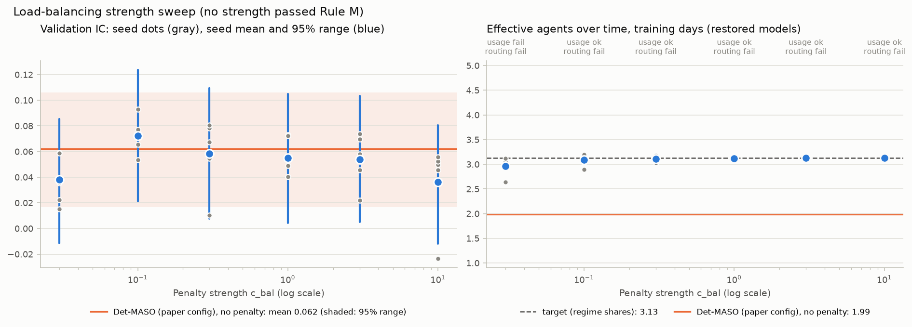
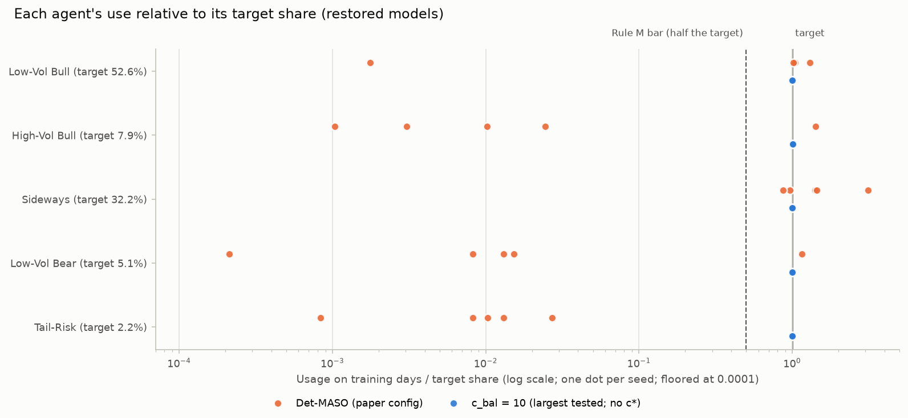
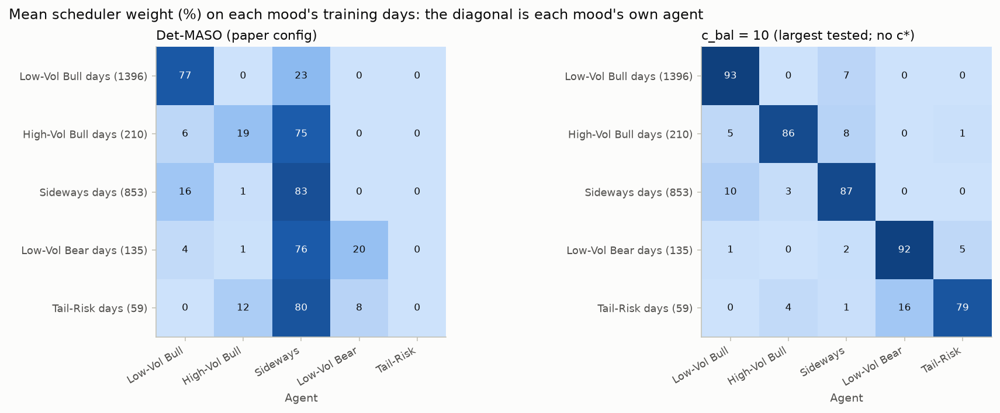

# Fixing the scheduler collapse with a load-balancing penalty (CSI300)

Run 2026-11-07 (TODO "Fix the scheduler collapse"). The rules used to judge it were written down before the first
run ([docs/RULES.md](../../../docs/RULES.md)) and applied by code. All numbers come from the **training days** or the
**validation period** (2023-01-03 to 2024-02-28: 278 trading days, IC on 258 of them); the locked test period was
not used. Five seeds per model; numbers are mean +- std over seeds or a 95% range. Generated tables:
[comparison.md](comparison.md) / [comparison.json](comparison.json); placebo: [placebo/](placebo/); pilots:
[pilot/usage.md](pilot/usage.md), [placebo/pilot/usage.md](placebo/pilot/usage.md); run log:
[EXPERIMENTS.md](../../../EXPERIMENTS.md) (E9-E17); try ledger: [trials.csv](../trials.csv).

## Answer: dropped, "all agents used, but no specialists"

**The penalty fixes the collapse in the usage sense, but the agents do not reliably become specialists, and
validation IC does not move.** From strength 0.1 up, in every seed and for both the restored and the last-epoch
model, every agent gets at least half of its target share of the training days (the paper's models give the three
rare-mood agents 0.0-0.2% in 4 of 5 seeds, and seed 1 hands everything to one agent). Effective agents over time on
the training days rise from 1.99 to 3.08-3.13, against a target of 3.13. The agents mostly specialize too: at the
strongest setting (10) each mood's own agent carries 79-93% of the weight on its mood's days, against 0-83% for the
paper's models. But at every strength at least one seed fails to route some rare mood's days mainly to that mood's
agent, almost always the Tail-Risk mood (59 training days, all in 2015); at strength 10 it is a single check out of
50 (Tail-Risk, seed 1, restored model). The rule fixed in advance asks for every seed, mood and checkpoint, so it
reports **"all agents used, but no specialists"**; the owner kept the rule as written, so **the change is dropped**
(the penalty stays in the code behind `loss.c_bal`, off by default). On
validation no strength differs detectably from the paper Det-MASO (IC 0.036-0.072 vs 0.062; every 95% range of the
difference spans 0) and all stay below the single network (0.103). That was expected: the validation period
contains only the two common moods, so rare-mood specialists cannot show there. The luck checks agree that nothing
here is a real gain: the placebo passed (shuffled answers give an average IC of +0.005, 95% range -0.006 to
+0.016), and the balanced variants' deflated Sharpe is 5-8% and deflated IC 19-72% after 16 tries.

## What was added

- **The penalty** (`loss.c_bal`, off by default): each training step, the scheduler (a tiny network) is run on the
  12 market numbers of all 2,653 training days, its weights are averaged per agent ("usage"), and the loss adds
  c_bal x KL(target || usage). The target is each mood's share of the training days (`loss.balance_target: regime`):
  Low-Vol Bull 52.6%, High-Vol Bull 7.9%, Sideways 32.2%, Low-Vol Bear 5.1%, Tail-Risk 2.2%. Everything else is the
  paper config. Cost: about 1 ms per step.
- **The guard tooling** (CLAUDE.md "Guards"): the try ledger, deflated Sharpe and deflated IC in `compare`, the
  placebo config section, training-only pilot runs, the rules as code (`compare --rule scheduler_balance`), and
  `detmaso usage` for training-day scheduler diagnostics.

## How it was run (in the order the rules require)

1. **Paper config unchanged** (E9): retraining it with the new code gave models identical to `final` in every
   weight (sha256 equal to the test lock); re-evaluating `final` reproduced its validation report byte for byte.
2. **Placebo first** (Rule P, E10): the whole procedure on shuffled answers. Within each 20-day block, the stocks
   labelled every day of the block (93% of training stock-days) get another such stock's 20-day and next-day
   returns. Its pilot set a placebo grid of 3e-6 to 1e-3; 8 run groups x 5 seeds were trained and evaluated.
   - Average placebo IC over the 8 groups: **+0.0048 [-0.0056, +0.0157]**, so the process (early stopping included)
     finds nothing: P1 passes. No placebo strength passed Rule M (without a signal the scheduler drifts and these
     weak penalties do not hold every seed at the target), so no strength was chosen and P2 does not apply.
     **Placebo passed.**
   - Placebo excess Sharpe was positive in all 8 groups (0.13 to 0.99), but their daily excess returns are strongly
     correlated (0.43 on average: the models share a common tilt and all see the same shuffled returns), so this is
     one draw, with t = 1.7 by the daily formula, which overstates certainty because each shuffled partner is held
     for 20 days. Not part of Rule P; no sign of a leak.
3. **Pilot** (Rule G, E11): 6 strengths x 2 seeds x 8 epochs, validation switched off (not tries).

   | Pilot strength | 1e-5 | 1e-4 | 1e-3 | 1e-2 | 0.1 | 1 |
   |---|---|---|---|---|---|---|
   | Every agent >= half its target, both seeds, epoch 8 | no | no | no | no | yes | yes |

   Anchor 0.1, so the **grid is 0.03, 0.1, 0.3, 1, 3, 10** (logged in docs/RULES.md before the sweep). Gradient
   clipping was active on 1-3% of steps at every strength, so the penalty did not drown out the other loss terms.
4. **Sweep** (E12-E17): 6 strengths x 5 seeds, the paper's training recipe; Rules M and S applied by code.

## Results

| Model | Try # | Validation IC [95% range] | Det-MASO's IC lead [95% range] | Sharpe | Deflated Sharpe | Deflated IC | Usage (M1) | Routing (M2) |
|---|---|---|---|---|---|---|---|---|
| Det-MASO, paper config (`final`) | 6 | 0.062 +- 0.010 [+0.017, +0.106] | - | 0.02 +- 0.41 | 14% | 58% | fail | fail |
| Penalty 0.03 | 11 | 0.038 +- 0.020 [-0.012, +0.085] | +0.024 [-0.011, +0.058] | -0.32 +- 0.48 | 5% | 22% | fail | fail |
| Penalty 0.1 | 13 | 0.072 +- 0.015 [+0.021, +0.124] | -0.010 [-0.038, +0.015] | -0.21 +- 0.32 | 8% | 72% | pass | fail |
| Penalty 0.3 | 16 | 0.058 +- 0.029 [+0.008, +0.109] | +0.004 [-0.031, +0.041] | -0.31 +- 0.43 | 5% | 52% | pass | fail |
| Penalty 1 | 12 | 0.055 +- 0.016 [+0.004, +0.105] | +0.007 [-0.024, +0.040] | -0.17 +- 0.27 | 8% | 47% | pass | fail |
| Penalty 3 | 14 | 0.054 +- 0.021 [+0.005, +0.103] | +0.008 [-0.024, +0.040] | -0.31 +- 0.31 | 5% | 45% | pass | fail |
| Penalty 10 | 15 | 0.036 +- 0.033 [-0.012, +0.080] | +0.026 [-0.012, +0.074] | -0.30 +- 0.33 | 5% | 19% | pass | fail |
| Single network (Step 1 baseline) | 8 | 0.103 +- 0.002 [+0.039, +0.169] | -0.041 [-0.088, +0.010] | 0.66 +- 0.29 | 73% | 92% | - | - |
| Single network + mood inputs | 10 | 0.140 +- 0.014 [+0.062, +0.217] | -0.078 [-0.142, -0.018] | 0.69 +- 0.26 | 52% | 98% | - | - |

- Det-MASO's IC lead = paper Det-MASO minus the row (negative = the row did better), with the paired 20-day block
  resampling of Step 1. Every penalty row's range spans 0: **no detectable difference** from the paper Det-MASO.
- Sharpe is the yearly return per unit of bumpiness of the daily top-10% portfolio; 2023 was a falling market. No
  Sharpe difference from the paper Det-MASO is detectable either (all 95% ranges span 0; see comparison.md).
- Deflated = the probability that the value beats the best of 16 tries of pure luck (Sharpe on the daily excess
  return over the stocks the portfolio could buy; IC with the resampling's uncertainty). Above about 95% = likely
  real. Only the single network with mood inputs reaches it, for IC.
- Usage (M1) = every agent gets at least half its target share of the training days; routing (M2) = on each mood's
  training days that mood's own agent has the largest weight. Both must hold in every seed for the restored and the
  last-epoch model.



### How the scheduler uses the agents (the TODO's report list)

| Model | Usage on training days, % (seed mean) | Effective agents over time, training | Own agent's weight on its mood's days, % | Weights on validation days | Per-day entropy, validation | Dead agent-days in training (all epochs) |
|---|---|---|---|---|---|---|
| Target | 52.6, 7.9, 32.2, 5.1, 2.2 | 3.13 | - | - | - | - |
| Paper (`final`) | 46.3, 2.3, 50.2, 1.2, 0.0 | 1.99 | 77, 19, 83, 20, 0 | 0.59, 0.00, 0.41, 0.00, 0.00 | 0.014 | Low-Vol Bear 1,429; High-Vol Bull 41 |
| Penalty 0.03 | 52.7, 7.5, 33.8, 4.5, 1.5 | 2.96 | 94, 53, 84, 58, 21 | 0.74, 0.01, 0.23, 0.01, 0.01 | 0.078 | Low-Vol Bear 4; Tail-Risk 5 |
| Penalty 0.1 | 50.2, 7.1, 35.8, 4.8, 2.1 | 3.08 | 88, 50, 87, 59, 26 | 0.60, 0.03, 0.33, 0.01, 0.02 | 0.191 | 0 |
| Penalty 0.3 | 52.3, 7.6, 32.9, 5.2, 2.1 | 3.11 | 94, 81, 89, 83, 29 | 0.72, 0.00, 0.27, 0.00, 0.01 | 0.023 | 0 |
| Penalty 1 | 52.3, 7.8, 32.6, 5.1, 2.2 | 3.12 | 93, 57, 85, 69, 68 | 0.68, 0.02, 0.29, 0.01, 0.00 | 0.047 | 0 |
| Penalty 3 | 52.3, 7.9, 32.5, 5.1, 2.2 | 3.13 | 94, 80, 84, 73, 36 | 0.67, 0.00, 0.31, 0.00, 0.01 | 0.049 | Tail-Risk 6,362 |
| Penalty 10 | 52.6, 7.9, 32.1, 5.1, 2.2 | 3.13 | 93, 86, 87, 92, 79 | 0.77, 0.00, 0.23, 0.00, 0.00 | 0.028 | Low-Vol Bear 4,699 |

Agent order: Low-Vol Bull, High-Vol Bull, Sideways, Low-Vol Bear, Tail-Risk. "Effective agents over time" is e to
the entropy of the usage (1 = one agent does everything; 3.13 = perfect mood specialists on these training days).
Per-day entropy (the paper's q2 check, max 1.61) stays low because each day still goes mostly to one agent, which is
what specialists should do. Dead agent-days (an agent's output constant across stocks, so its score that day is 0;
DEVIATIONS 4) are summed over seeds and epochs. At strengths 3 and 10 a single seed's rare-mood agent was dead on
many days for long stretches: strength 3, the Tail-Risk agent of seed 0 from epoch 22 to 44 (its restored model
still has 81 dead training days); strength 10, the Low-Vol Bear agent of seed 4 from epoch 5 to 29, after which it
recovered. A strong penalty keeps routing weight to such an agent even while its output is flat. On validation the
Low-Vol Bull and Sideways agents get 93-100% of the weight in every model, as expected: those are the only moods in
that period.




Which routing checks failed (out of 5 seeds x 2 checkpoints per mood):

| Strength | Tail-Risk | High-Vol Bull | Low-Vol Bear | Low-Vol Bull, Sideways |
|---|---|---|---|---|
| 0.03 | 7 | 2 | 2 | 0 |
| 0.1 | 6 | 3 | 2 | 0 |
| 0.3 | 6 | 0 | 0 | 0 |
| 1 | 2 | 2 | 0 | 0 |
| 3 | 4 | 1 | 1 | 0 |
| 10 | 1 | 0 | 0 | 0 |

## Early-stopping check

Every model's epoch is still picked by validation IC. Picking added +0.005 to +0.034 IC to the penalty rows
(validation IC averaged over every epoch trained: 0.021-0.047, against 0.043 for the paper config); details in
comparison.md.

## Caveats

- **Validation cannot test the specialists.** It contains only the two common moods; the rare moods occur in
  2014-2016 and 2019-2020. Walk-forward can test them only partly (High-Vol Bull in the 2015, 2019 and 2020 folds,
  Low-Vol Bear in 2016, Tail-Risk never: all 59 of its days are in 2015 and no earlier year has any).
- **Early stopping uses the validation days compared here**, so headline ICs are optimistic (see above).
- **One short, falling-market period** (2023 to February 2024).
- **The routing rule is strict**: every seed, every mood (including Tail-Risk with 59 days) and both checkpoints.
  It was fixed in advance and is applied as written.

## Decision

Rule S stops the process when usage is fixed but specialists do not form reliably; extending the grid or changing a
rule needs the owner's OK (docs/RULES.md). The options were: keep the rule as written; change the routing rule
(for example leave Tail-Risk out, or require 4 of 5 seeds), logged with its reason; or extend the grid to 30 and
100. On 2026-11-07 the owner **kept the rule as written**: the six strengths (EXPERIMENTS E12-E17) are dropped and
listed in the README's "What didn't work". The penalty, the pilot mode and the routing diagnostics stay in the
code for later steps (for example a walk-forward version with its own pre-written rules).

## Assumptions

- **P1 Penalty:** KL(target || usage), usage over all 2,653 training days (train_fit), dead agent-days not
  excluded inside the penalty (the scheduler alone is run; dead flags need the agents). Rule M's usage does exclude
  dead days.
- **P2 Target:** each K-means mood's share of the training days (frozen regimes of the MVP).
- **P3 Everything else is the paper config**, including the per-day entropy bonus 0.01, the mood mask 0.1 and the
  diversity penalty 0.1, the training recipe and early stopping; 5 seeds (0-4).
- **P4 Placebo:** 20-day blocks counted from the first model date; a random cycle over the stocks labelled on every
  day of the block (no stock keeps its own answers); other stocks left out of training, IC and the portfolio for
  that block; placebo seed 0.

## Checks that the paper configuration did not change

- The paper config's fingerprint (`d2a65e9a6a237d2c`) and data fingerprint (`8e81084fb70adad6`) still equal those in
  the test lock (permanent test); the golden synthetic training test passes with its values untouched.
- Retraining the paper config with this code (`paper_rerun2`, 5 seeds) gave models identical to `final` in every
  weight, curve and epoch; each model file's sha256 equals the one in `locks/csi300_test.json`.
- Re-evaluating `final` reproduced its validation report, results file and daily series byte for byte.

## Reproduce

```bash
# pilot (training only), then Rule G
for c in c1e-5 c1e-4 c1e-3 c1e-2 c1e-1 c1e0; do
  uv run detmaso train --config configs/scheduler_balance/pilot/pilot_$c.yaml --tag bal_pilot_$c
done
uv run detmaso usage --grid --out results/csi300/scheduler_balance/pilot \
    --runs configs/scheduler_balance/pilot/pilot_c1e-5.yaml:bal_pilot_c1e-5 ...   # all six pilot runs
# sweep (same for placebo/ with placebo_ tags, run first)
for c in c3e-2 c1e-1 c3e-1 c1e0 c3e0 c1e1; do
  uv run detmaso train    --config configs/scheduler_balance/bal_$c.yaml --tag bal_$c
  uv run detmaso evaluate --config configs/scheduler_balance/bal_$c.yaml --tag bal_$c --split valid
  uv run detmaso usage    --runs configs/scheduler_balance/bal_$c.yaml:bal_$c
done
uv run detmaso usage   --runs configs/csi300.yaml:final
uv run detmaso compare --rule scheduler_balance --reference final --out results/csi300/scheduler_balance \
    --runs configs/csi300.yaml:final configs/csi300_single_mlp.yaml:single_mlp \
           configs/csi300_single_mlp_state.yaml:single_mlp_state configs/scheduler_balance/bal_c3e-2.yaml:bal_c3e-2 ...
```
