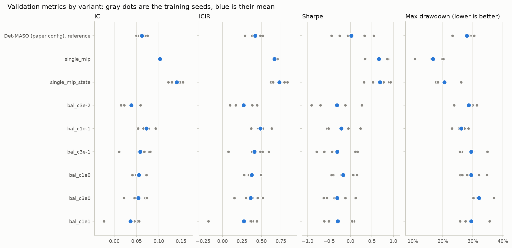
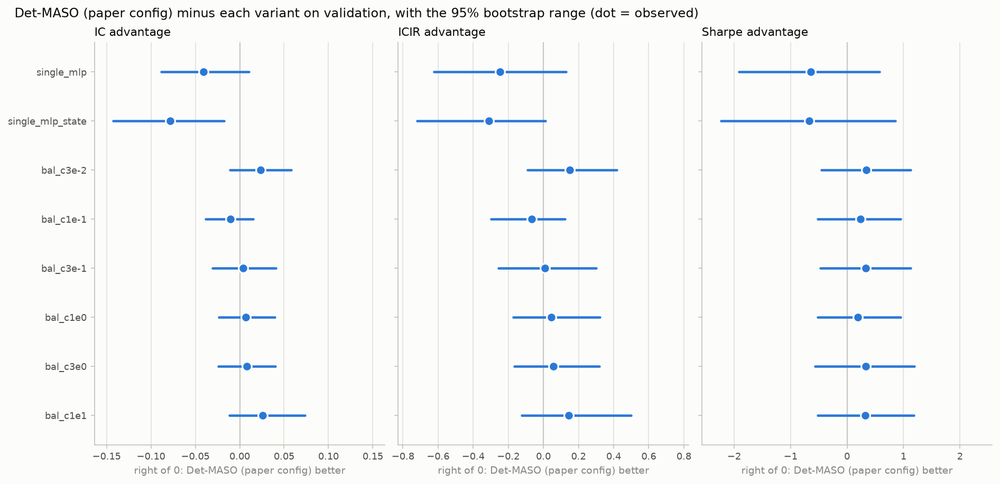
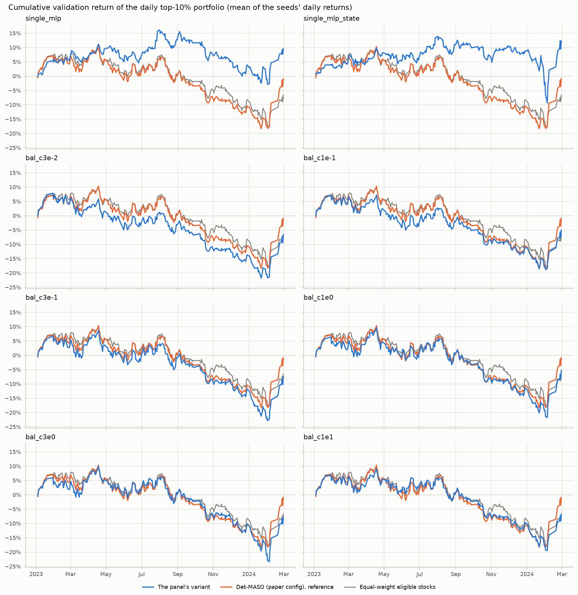
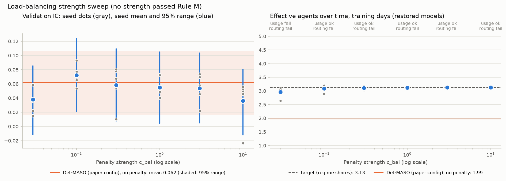
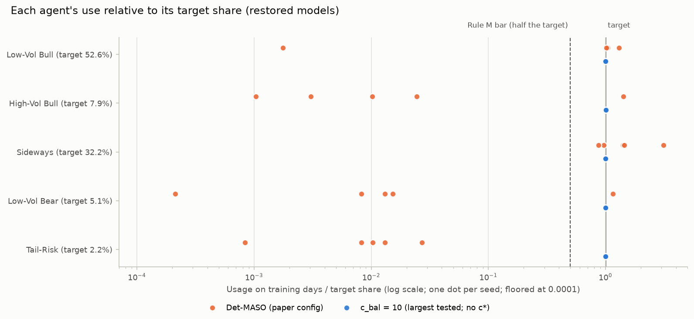
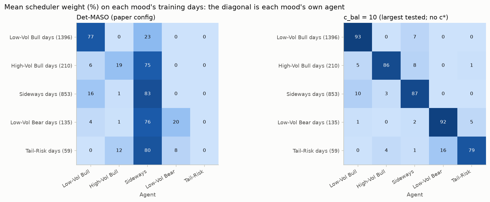

# Variant comparison: csi300, validation split

- Reference: `paper` (run group `final`). Advantage = reference minus variant (drawdown: variant minus reference), so a positive number means the reference did better.
- Evaluated dates: 2023-01-03 .. 2024-02-28 (278 trading days; IC uses 258). The test period is not used.
- Data tag `2026-11-04`, data hash `8e81084fb70adad6` (shared by every run group).
- Bootstrap: 10,000 draws; days redrawn in circular 20-day blocks (one draw shared by all variants); seeds redrawn per variant from its own random stream; RNG seed 0.
- Rule fixed in advance (Step 1 decision D3): the reference is better if the 95% range lies entirely above 0, the variant is better if entirely below 0, otherwise no detectable difference. IC is primary; Sharpe is the second opinion.

## Run groups

| Variant | Config | Run group | Config hash | Model | Weights | Seeds |
|---|---|---|---|---|---|---|
| `paper` | `configs/csi300.yaml` | `final` | `d2a65e9a6a237d2c` | detmaso | 26,634 | 0 1 2 3 4 |
| `single_mlp` | `configs/csi300_single_mlp.yaml` | `single_mlp` | `ef0560a807c0b155` | single_mlp | 4,865 | 0 1 2 3 4 |
| `single_mlp_state` | `configs/csi300_single_mlp_state.yaml` | `single_mlp_state` | `d38afb377e8a652b` | single_mlp | 5,633 | 0 1 2 3 4 |
| `bal_c3e-2` | `configs/scheduler_balance/bal_c3e-2.yaml` | `bal_c3e-2` | `5e6205840602a67a` | detmaso | 26,634 | 0 1 2 3 4 |
| `bal_c1e-1` | `configs/scheduler_balance/bal_c1e-1.yaml` | `bal_c1e-1` | `36f4924f33ff1153` | detmaso | 26,634 | 0 1 2 3 4 |
| `bal_c3e-1` | `configs/scheduler_balance/bal_c3e-1.yaml` | `bal_c3e-1` | `7cec9a9df1982f8d` | detmaso | 26,634 | 0 1 2 3 4 |
| `bal_c1e0` | `configs/scheduler_balance/bal_c1e0.yaml` | `bal_c1e0` | `6cf6709dc4c7b083` | detmaso | 26,634 | 0 1 2 3 4 |
| `bal_c3e0` | `configs/scheduler_balance/bal_c3e0.yaml` | `bal_c3e0` | `2be8c2d2b3b14e8d` | detmaso | 26,634 | 0 1 2 3 4 |
| `bal_c1e1` | `configs/scheduler_balance/bal_c1e1.yaml` | `bal_c1e1` | `521e530361af914f` | detmaso | 26,634 | 0 1 2 3 4 |

## Metrics (mean +- std over seeds)

| Variant | IC | ICIR | Sharpe | Max drawdown | Annual return | Excess AR | Excess Sharpe |
|---|---|---|---|---|---|---|---|
| `paper` | 0.0620 +- 0.0102 | 0.420 +- 0.091 | 0.02 +- 0.41 | 28.0% +- 2.8% | -0.9% +- 7.0% | 5.1% | 0.47 |
| `single_mlp` | 0.1028 +- 0.0024 | 0.668 +- 0.026 | 0.66 +- 0.29 | 16.7% +- 3.8% | 8.3% +- 4.0% | 14.4% | 2.04 |
| `single_mlp_state` | 0.1404 +- 0.0142 | 0.729 +- 0.092 | 0.69 +- 0.26 | 20.6% +- 3.3% | 10.6% +- 4.7% | 17.0% | 1.52 |
| `bal_c3e-2` | 0.0382 +- 0.0203 | 0.270 +- 0.144 | -0.32 +- 0.48 | 28.7% +- 2.9% | -5.6% +- 6.5% | -0.0% | -0.03 |
| `bal_c1e-1` | 0.0724 +- 0.0146 | 0.488 +- 0.098 | -0.21 +- 0.32 | 26.1% +- 2.1% | -4.4% +- 4.9% | 1.2% | 0.19 |
| `bal_c3e-1` | 0.0583 +- 0.0286 | 0.411 +- 0.201 | -0.31 +- 0.43 | 29.5% +- 3.7% | -6.5% +- 6.9% | -0.8% | -0.07 |
| `bal_c1e0` | 0.0550 +- 0.0165 | 0.374 +- 0.110 | -0.17 +- 0.27 | 29.4% +- 3.8% | -4.6% +- 4.8% | 1.2% | 0.18 |
| `bal_c3e0` | 0.0538 +- 0.0210 | 0.363 +- 0.142 | -0.31 +- 0.31 | 32.1% +- 2.8% | -6.9% +- 5.2% | -1.1% | -0.05 |
| `bal_c1e1` | 0.0361 +- 0.0335 | 0.275 +- 0.257 | -0.30 +- 0.33 | 29.5% +- 3.7% | -6.1% +- 5.2% | -0.5% | -0.03 |

## Uncertainty and luck

| Variant | Try # | IC [95% range] | Sharpe [95% range] | Deflated Sharpe (excess) | Deflated IC |
|---|---|---|---|---|---|
| `paper` | 6 | 0.0620 [+0.0168, +0.1060] | 0.02 [-2.18, +2.17] | 14% | 58% |
| `single_mlp` | 8 | 0.1028 [+0.0390, +0.1690] | 0.66 [-1.26, +2.44] | 73% | 92% |
| `single_mlp_state` | 10 | 0.1404 [+0.0622, +0.2172] | 0.69 [-1.01, +2.37] | 52% | 98% |
| `bal_c3e-2` | 11 | 0.0382 [-0.0115, +0.0854] | -0.32 [-2.60, +1.93] | 5% | 22% |
| `bal_c1e-1` | 13 | 0.0724 [+0.0211, +0.1236] | -0.21 [-2.31, +1.86] | 8% | 72% |
| `bal_c3e-1` | 16 | 0.0583 [+0.0076, +0.1094] | -0.31 [-2.50, +1.86] | 5% | 52% |
| `bal_c1e0` | 12 | 0.0550 [+0.0043, +0.1049] | -0.17 [-2.32, +1.84] | 8% | 47% |
| `bal_c3e0` | 14 | 0.0538 [+0.0050, +0.1034] | -0.31 [-2.38, +1.62] | 5% | 45% |
| `bal_c1e1` | 15 | 0.0361 [-0.0117, +0.0804] | -0.30 [-2.26, +1.63] | 5% | 19% |

95% range = the 2.5-97.5% percentiles of the seed-mean level over the bootstrap draws above.
Deflated numbers (CLAUDE.md guards): the probability that the true value beats the best of 16 tries of pure luck (try ledger `trials.csv`; spread of the tries' daily excess Sharpe 0.0527 and IC 0.0317, from the 11 tries with validation metrics). Above about 95% = likely real. Deflated Sharpe uses the daily excess return over the equal-weighted eligible stocks; deflated IC uses the bootstrap standard error.

## Advantage of `paper` over each variant (95% bootstrap range)

| Variant | IC adv. [95%] | P(>0) | ICIR adv. [95%] | P(>0) | Sharpe adv. [95%] | P(>0) | IC rule | Sharpe rule | MDD adv. |
|---|---|---|---|---|---|---|---|---|---|
| `single_mlp` | -0.0409 [-0.0882, +0.0102] | 5% | -0.248 [-0.622, +0.128] | 8% | -0.64 [-1.91, +0.57] | 13% | no detectable difference | no detectable difference | -11.2% |
| `single_mlp_state` | -0.0784 [-0.1423, -0.0177] | 0% | -0.309 [-0.720, +0.011] | 3% | -0.67 [-2.24, +0.85] | 17% | variant better | no detectable difference | -7.4% |
| `bal_c3e-2` | +0.0238 [-0.0109, +0.0579] | 92% | +0.150 [-0.091, +0.417] | 91% | +0.34 [-0.45, +1.13] | 81% | no detectable difference | no detectable difference | +0.7% |
| `bal_c1e-1` | -0.0104 [-0.0384, +0.0154] | 20% | -0.068 [-0.298, +0.123] | 22% | +0.24 [-0.52, +0.95] | 73% | no detectable difference | no detectable difference | -1.9% |
| `bal_c3e-1` | +0.0037 [-0.0306, +0.0407] | 58% | +0.009 [-0.256, +0.301] | 53% | +0.33 [-0.47, +1.13] | 79% | no detectable difference | no detectable difference | +1.5% |
| `bal_c1e0` | +0.0070 [-0.0235, +0.0398] | 68% | +0.046 [-0.173, +0.321] | 68% | +0.19 [-0.52, +0.95] | 71% | no detectable difference | no detectable difference | +1.5% |
| `bal_c3e0` | +0.0082 [-0.0244, +0.0403] | 71% | +0.057 [-0.167, +0.320] | 72% | +0.33 [-0.57, +1.19] | 78% | no detectable difference | no detectable difference | +4.1% |
| `bal_c1e1` | +0.0259 [-0.0118, +0.0736] | 91% | +0.145 [-0.125, +0.501] | 86% | +0.32 [-0.52, +1.18] | 76% | no detectable difference | no detectable difference | +1.5% |

P(>0) = share of bootstrap draws in which the reference did better.

## Early-stopping check

| Variant | IC at the picked epoch (headline) | Validation IC averaged over every epoch | Gain from picking | Mean epochs trained |
|---|---|---|---|---|
| `paper` | 0.0620 | 0.0426 | +0.0194 | 16.8 |
| `single_mlp` | 0.1028 | 0.0932 | +0.0097 | 18.6 |
| `single_mlp_state` | 0.1404 | 0.0987 | +0.0417 | 13.0 |
| `bal_c3e-2` | 0.0382 | 0.0336 | +0.0046 | 15.6 |
| `bal_c1e-1` | 0.0724 | 0.0468 | +0.0257 | 15.2 |
| `bal_c3e-1` | 0.0583 | 0.0338 | +0.0245 | 23.0 |
| `bal_c1e0` | 0.0550 | 0.0214 | +0.0337 | 21.6 |
| `bal_c3e0` | 0.0538 | 0.0338 | +0.0199 | 28.6 |
| `bal_c1e1` | 0.0361 | 0.0240 | +0.0121 | 22.4 |

Each model's epoch was picked by the smoothed validation IC, i.e. on the same days compared here, so the headline IC is
optimistic, most of all for runs whose validation IC swings from epoch to epoch. The all-epoch average involves no picking.

## Agents and scheduler (multi-agent variants)

| Variant | Mean abs agent rank corr | Scheduler entropy (max ln n) | Effective agents per day | Effective agents over time | Mean agent weights |
|---|---|---|---|---|---|
| `paper` | 0.102 | 0.014 (max 1.61) | 1.02 | 1.57 | [0.591, 0.0, 0.408, 0.0, 0.0] |
| `bal_c3e-2` | 0.127 | 0.078 (max 1.61) | 1.13 | 1.95 | [0.743, 0.011, 0.231, 0.007, 0.008] |
| `bal_c1e-1` | 0.142 | 0.191 (max 1.61) | 1.33 | 2.37 | [0.604, 0.034, 0.328, 0.01, 0.024] |
| `bal_c3e-1` | 0.129 | 0.023 (max 1.61) | 1.04 | 1.90 | [0.718, 0.004, 0.271, 0.002, 0.005] |
| `bal_c1e0` | 0.113 | 0.047 (max 1.61) | 1.08 | 2.08 | [0.678, 0.022, 0.291, 0.007, 0.001] |
| `bal_c3e0` | 0.096 | 0.049 (max 1.61) | 1.08 | 2.03 | [0.669, 0.004, 0.313, 0.004, 0.01] |
| `bal_c1e1` | 0.129 | 0.028 (max 1.61) | 1.04 | 1.71 | [0.769, 0.002, 0.227, 0.001, 0.001] |

Validation days. Effective agents per day = mean over days of exp(scheduler entropy): 1 = one agent takes all the weight, n = equal weights.
Effective agents over time = exp(entropy of each seed's mean weights), averaged over seeds: how many agents are used across the period.

## Training days (restored model; from `detmaso usage`)

| Variant | Usage per agent, % (seed mean) | Effective agents over time | Dead agent-days, training (all epochs) | ... up to the restored epoch | Restored model, training days | Restored model, validation days |
|---|---|---|---|---|---|---|
| `paper` | 46.3, 2.3, 50.2, 1.2, 0.0 | 1.99 | [0, 41, 0, 1429, 0] | [0, 0, 0, 141, 0] | [0, 0, 0, 69, 0] | [0, 0, 0, 8, 0] |
| `bal_c3e-2` | 52.7, 7.5, 33.8, 4.5, 1.5 | 2.96 | [0, 0, 0, 4, 5] | [0, 0, 0, 0, 0] | [0, 0, 0, 0, 0] | [0, 0, 0, 0, 0] |
| `bal_c1e-1` | 50.2, 7.1, 35.8, 4.8, 2.1 | 3.08 | [0, 0, 0, 0, 0] | [0, 0, 0, 0, 0] | [0, 0, 0, 0, 0] | [0, 0, 0, 0, 0] |
| `bal_c3e-1` | 52.3, 7.6, 32.9, 5.2, 2.1 | 3.11 | [0, 0, 0, 0, 0] | [0, 0, 0, 0, 0] | [0, 0, 0, 0, 0] | [0, 0, 0, 0, 0] |
| `bal_c1e0` | 52.3, 7.8, 32.6, 5.1, 2.2 | 3.12 | [0, 0, 0, 0, 0] | [0, 0, 0, 0, 0] | [0, 0, 0, 0, 0] | [0, 0, 0, 0, 0] |
| `bal_c3e0` | 52.3, 7.9, 32.5, 5.1, 2.2 | 3.13 | [0, 0, 0, 0, 6362] | [0, 0, 0, 0, 4889] | [0, 0, 0, 0, 81] | [0, 0, 0, 0, 5] |
| `bal_c1e1` | 52.6, 7.9, 32.1, 5.1, 2.2 | 3.13 | [0, 0, 0, 4699, 0] | [0, 0, 0, 4699, 0] | [0, 0, 0, 0, 0] | [0, 0, 0, 0, 0] |

Usage counts an agent's dead days (constant output, score 0; DEVIATIONS 4) as 0. Dead agent-days are summed over seeds, per agent.

## Rules (docs/RULES.md, scheduler balance)

Target usage (regime shares of the training days), %: 52.6, 7.9, 32.2, 5.1, 2.2. Rule M must hold in every seed, for the restored model and the last epoch trained.

| Strength c_bal | Variant | M0 all seeds trained | M1 usage >= half target | M2 own agent leads its mood | Lowest usage / target | Rule M |
|---|---|---|---|---|---|---|
| 0.03 | `bal_c3e-2` | yes | **no** | **no** | 0.24 | fail |
| 0.1 | `bal_c1e-1` | yes | yes | **no** | 0.62 | fail |
| 0.3 | `bal_c3e-1` | yes | yes | **no** | 0.81 | fail |
| 1 | `bal_c1e0` | yes | yes | **no** | 0.94 | fail |
| 3 | `bal_c3e0` | yes | yes | **no** | 0.96 | fail |
| 10 | `bal_c1e1` | yes | yes | **no** | 0.99 | fail |

- **Rule S:** all agents used, but no specialists.
- **Outcome:** all agents used, but no specialists.

## Per seed

| Variant | Seed | IC | ICIR | Sharpe | Max drawdown | Annual return | Best epoch | Epochs |
|---|---|---|---|---|---|---|---|---|
| `paper` | 0 | 0.0617 | 0.422 | 0.33 | 29.2% | 4.6% | 13 | 21 |
| `paper` | 1 | 0.0494 | 0.289 | -0.07 | 28.8% | -3.2% | 4 | 12 |
| `paper` | 2 | 0.0687 | 0.519 | -0.25 | 30.4% | -5.7% | 8 | 16 |
| `paper` | 3 | 0.0552 | 0.383 | -0.44 | 28.1% | -8.5% | 10 | 18 |
| `paper` | 4 | 0.0748 | 0.487 | 0.54 | 23.3% | 8.1% | 9 | 17 |
| `single_mlp` | 0 | 0.1068 | 0.707 | 0.35 | 19.9% | 4.0% | 11 | 19 |
| `single_mlp` | 1 | 0.1026 | 0.682 | 0.90 | 10.7% | 11.0% | 4 | 12 |
| `single_mlp` | 2 | 0.1005 | 0.646 | 0.34 | 20.2% | 3.8% | 10 | 18 |
| `single_mlp` | 3 | 0.1017 | 0.647 | 0.88 | 16.8% | 11.3% | 14 | 22 |
| `single_mlp` | 4 | 0.1026 | 0.656 | 0.86 | 16.1% | 11.2% | 14 | 22 |
| `single_mlp_state` | 0 | 0.1497 | 0.833 | 0.52 | 20.5% | 7.7% | 4 | 12 |
| `single_mlp_state` | 1 | 0.1214 | 0.622 | 0.31 | 26.1% | 4.0% | 5 | 13 |
| `single_mlp_state` | 2 | 0.1474 | 0.749 | 0.77 | 17.7% | 11.6% | 5 | 13 |
| `single_mlp_state` | 3 | 0.1292 | 0.649 | 0.90 | 20.1% | 14.4% | 5 | 13 |
| `single_mlp_state` | 4 | 0.1541 | 0.795 | 0.93 | 18.3% | 15.3% | 6 | 14 |
| `bal_c3e-2` | 0 | 0.0151 | 0.096 | 0.27 | 23.8% | 3.1% | 3 | 11 |
| `bal_c3e-2` | 1 | 0.0591 | 0.446 | -0.12 | 29.9% | -3.7% | 8 | 16 |
| `bal_c3e-2` | 2 | 0.0356 | 0.256 | -0.70 | 29.3% | -10.9% | 10 | 18 |
| `bal_c3e-2` | 3 | 0.0224 | 0.172 | -0.90 | 29.1% | -13.1% | 7 | 15 |
| `bal_c3e-2` | 4 | 0.0588 | 0.382 | -0.12 | 31.3% | -3.5% | 10 | 18 |
| `bal_c1e-1` | 0 | 0.0770 | 0.519 | -0.21 | 27.2% | -4.6% | 11 | 19 |
| `bal_c1e-1` | 1 | 0.0728 | 0.455 | 0.24 | 23.0% | 2.6% | 3 | 11 |
| `bal_c1e-1` | 2 | 0.0931 | 0.634 | -0.54 | 26.3% | -9.2% | 7 | 15 |
| `bal_c1e-1` | 3 | 0.0656 | 0.460 | -0.51 | 28.6% | -8.7% | 6 | 14 |
| `bal_c1e-1` | 4 | 0.0536 | 0.370 | -0.05 | 25.4% | -2.1% | 9 | 17 |
| `bal_c3e-1` | 0 | 0.0105 | 0.078 | -0.43 | 30.3% | -8.9% | 13 | 21 |
| `bal_c3e-1` | 1 | 0.0547 | 0.382 | -0.61 | 34.9% | -12.0% | 19 | 27 |
| `bal_c3e-1` | 2 | 0.0782 | 0.595 | 0.17 | 26.4% | 1.4% | 13 | 21 |
| `bal_c3e-1` | 3 | 0.0675 | 0.487 | -0.79 | 30.0% | -13.2% | 9 | 17 |
| `bal_c3e-1` | 4 | 0.0805 | 0.513 | 0.12 | 25.6% | 0.5% | 21 | 29 |
| `bal_c1e0` | 0 | 0.0403 | 0.274 | -0.41 | 34.7% | -8.6% | 13 | 21 |
| `bal_c1e0` | 1 | 0.0403 | 0.277 | 0.15 | 25.8% | 1.1% | 8 | 16 |
| `bal_c1e0` | 2 | 0.0730 | 0.491 | 0.06 | 26.4% | -0.4% | 11 | 19 |
| `bal_c1e0` | 3 | 0.0492 | 0.336 | -0.44 | 32.1% | -9.8% | 23 | 31 |
| `bal_c1e0` | 4 | 0.0723 | 0.494 | -0.21 | 28.1% | -5.4% | 13 | 21 |
| `bal_c3e0` | 0 | 0.0579 | 0.390 | 0.12 | 30.1% | 0.5% | 36 | 44 |
| `bal_c3e0` | 1 | 0.0698 | 0.517 | -0.12 | 31.4% | -4.0% | 34 | 42 |
| `bal_c3e0` | 2 | 0.0219 | 0.153 | -0.62 | 31.8% | -11.0% | 4 | 12 |
| `bal_c3e0` | 3 | 0.0456 | 0.303 | -0.55 | 37.0% | -12.2% | 18 | 26 |
| `bal_c3e0` | 4 | 0.0737 | 0.452 | -0.37 | 30.2% | -7.8% | 11 | 19 |
| `bal_c1e1` | 0 | -0.0234 | -0.181 | 0.08 | 25.7% | 0.0% | 4 | 12 |
| `bal_c1e1` | 1 | 0.0458 | 0.389 | -0.49 | 29.3% | -9.0% | 4 | 12 |
| `bal_c1e1` | 2 | 0.0497 | 0.358 | -0.61 | 27.6% | -9.8% | 8 | 16 |
| `bal_c1e1` | 3 | 0.0525 | 0.367 | -0.50 | 35.6% | -10.8% | 14 | 22 |
| `bal_c1e1` | 4 | 0.0558 | 0.441 | 0.04 | 29.2% | -0.9% | 42 | 50 |

## Figures

