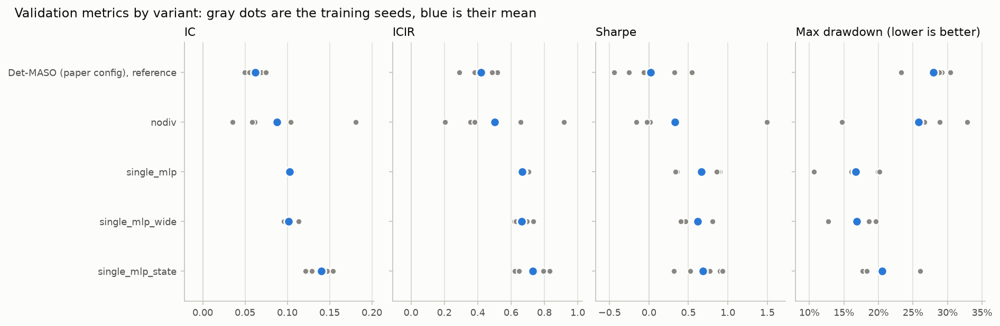
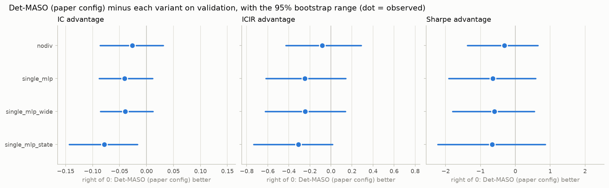
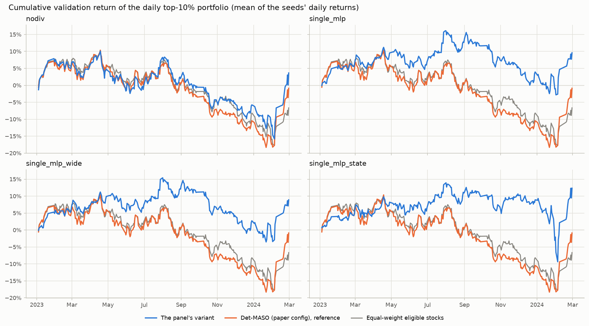

# Does the 5-agent idea help? Det-MASO vs a single network (CSI300, validation)

Step 1 ([ROADMAP.md](../../../ROADMAP.md)), run 2026-11-06. All numbers are on the **validation
period** (2023-01-03 to 2024-02-28: 278 trading days, IC on 258 of them); the locked test period was
not used. Five training seeds per model; numbers are mean +- std over seeds. Full tables:
[comparison.md](comparison.md); machine-readable: [comparison.json](comparison.json); run log:
[EXPERIMENTS.md](../../../EXPERIMENTS.md) (E4-E8).

Note (2026-11-07): the 95% ranges here, and in comparison.md and
[state_vs_plain/comparison.md](state_vs_plain/comparison.md), come from the earlier resampling method, in
which every model's seeds were redrawn from one shared random stream. `detmaso compare` now redraws each
model's seeds from a stream of its own ([docs/RULES.md](../../../docs/RULES.md), "Rule changes"); that moves
the ranges by about 0.01 and changes no verdict.

## Answer: does Det-MASO beat a single network on our data?

**No.** A single network the size of one Det-MASO agent, trained with only the IC and Sharpe loss
terms, scored better than Det-MASO on every metric: IC 0.103 vs 0.062, ICIR 0.67 vs 0.42, Sharpe 0.66
vs 0.02, max drawdown 16.7% vs 28.0%. Under the rule fixed before the runs (Det-MASO "beats" the single
network only if the 95% range of its IC advantage lies entirely above 0), the formal verdict is **no
detectable difference**: Det-MASO's IC advantage is -0.041 with a 95% range of -0.088 to +0.011, which
just touches 0, and Det-MASO came out ahead in only 5% of the 10,000 resampled draws; Sharpe points the
same way (-0.64, range -1.91 to +0.58). The single network's lead does not come from picking its best
epoch on these validation days: averaged over every epoch trained, its validation IC is 0.093 against
Det-MASO's 0.043. Nor is it about size: a single network with as many weights as all of Det-MASO
scores the same (IC 0.101). Switching off Det-MASO's diversity penalty changes nothing detectable (IC
0.088, Det-MASO's advantage range -0.086 to +0.031) but makes the results much less stable from seed to
seed (IC 0.035 to 0.181). The only comparison that crosses the rule is a single network that also sees
the 12 market-mood numbers: it beats Det-MASO on IC (Det-MASO's advantage -0.078, range -0.144 to
-0.017), but its edge over the plain single network is not detectable (+0.038, range -0.025 to +0.101)
and mostly comes from epoch picking (0.140 at the picked epoch, 0.099 averaged over epochs). So on our
data the 5-agent machinery adds nothing over one plain network, and the best estimate is that it costs
about 0.04 IC. Caveats: this is one short, falling-market period; every model's epoch was chosen on the
same validation days; and Det-MASO's scheduler is collapsed (about one agent per day), so this tests
Det-MASO as it trains with the paper's settings, not a working 5-specialist system (that is Step 2).
Step 3 re-checks this under walk-forward evaluation.

## Results table

| Row | Model | IC | ICIR | Sharpe | Max drawdown | Det-MASO's IC advantage [95% range] | Rule (IC) |
|---|---|---|---|---|---|---|---|
| R0 | Det-MASO, paper config (`final`, reference) | 0.062 +- 0.010 | 0.42 +- 0.09 | 0.02 +- 0.41 | 28.0% +- 2.8% | - | - |
| R1 | Det-MASO, no diversity penalty (c_div = 0) | 0.088 +- 0.058 | 0.50 +- 0.28 | 0.33 +- 0.67 | 25.8% +- 6.7% | -0.026 [-0.086, +0.031] | no detectable difference |
| R2 | **Single network, one-agent size (main comparison)** | 0.103 +- 0.002 | 0.67 +- 0.03 | 0.66 +- 0.29 | 16.7% +- 3.8% | -0.041 [-0.088, +0.011] | no detectable difference |
| R3 | Single network, Det-MASO size (26,731 weights) | 0.101 +- 0.007 | 0.67 +- 0.05 | 0.62 +- 0.19 | 16.9% +- 2.6% | -0.040 [-0.086, +0.012] | no detectable difference |
| R4 | Single network + 12 market-mood inputs | 0.140 +- 0.014 | 0.73 +- 0.09 | 0.69 +- 0.26 | 20.6% +- 3.3% | -0.078 [-0.144, -0.017] | single network better |

Advantage = Det-MASO minus the row (negative = the row did better). The 95% range comes from 10,000
resampled versions of the validation period: days are redrawn in 20-day chunks (neighbouring days'
20-day returns overlap, so single days are not independent), the same chunks for every row, and each
row's five seeds are redrawn too. Sharpe ranges, ICIR ranges and per-seed numbers are in
[comparison.md](comparison.md). R4 against the plain single network R2:
[state_vs_plain/comparison.md](state_vs_plain/comparison.md) (IC +0.038 [-0.025, +0.101], Sharpe +0.02
[-1.12, +1.34]: no detectable difference).





## What the diversity penalty changes (R0 vs R1)

| | Det-MASO (R0) | No diversity penalty (R1) |
|---|---|---|
| Mean absolute rank correlation between agents | 0.10 | 0.41 |
| Scheduler entropy (max 1.61) | 0.014 | 0.051 |
| Effective agents per day (1 = one agent takes all the weight) | 1.02 | 1.07 |
| Mean agent weights (Low-Vol Bull, High-Vol Bull, Sideways, Low-Vol Bear, Tail-Risk) | 0.59, 0.00, 0.41, 0.00, 0.00 | 0.25, 0.01, 0.58, 0.00, 0.16 |

The penalty does keep the agents different (correlation 0.10 instead of 0.41), but in both versions the
scheduler gives nearly all of each day's weight to one agent, so the "5 specialists" are never really
combined.

## Early-stopping check

Every model's epoch was picked by the 3-epoch-smoothed validation IC, on the same days compared above,
which flatters models whose validation IC swings from epoch to epoch.

| Row | IC at the picked epoch | Validation IC averaged over every epoch trained | Gain from picking |
|---|---|---|---|
| R0 Det-MASO | 0.062 | 0.043 | +0.019 |
| R1 no diversity | 0.088 | 0.043 | +0.045 |
| R2 single network | 0.103 | 0.093 | +0.010 |
| R3 single, Det-MASO size | 0.101 | 0.095 | +0.007 |
| R4 single + market mood | 0.140 | 0.099 | +0.042 |

## Step 1 decisions (approved by the owner, 2026-11-06)

These are the Step 1 decisions D1-D4, not the plan's D1-D10 in [docs/PLAN.md](../../../docs/PLAN.md).

- **D1 = c, which single networks:** both sizes: one shaped like one Det-MASO agent (R2, the main comparison) and one with as many weights as all of Det-MASO (R3).
- **D2 = b, market-state information:** add a row in which the single network also sees the scheduler's 12 market-state inputs (R4).
- **D3 = b, what "beats" means:** 5-seed means plus a paired block bootstrap with 10,000 draws, 20-day blocks and RNG seed 0. Rule fixed before seeing any results: the reference is better if the 95% range of its advantage lies entirely above 0, the variant is better if it lies entirely below 0, otherwise there is no detectable difference. IC is primary; Sharpe is the second opinion. The settings are constants in `src/detmaso/eval/compare.py`, not command-line options.
- **D4 = a, training recipe:** every row is trained with Det-MASO's recipe unchanged (B5).

## Assumptions

Single networks (R2; R3 and R4 differ only as stated):

- **B1 Shape:** 34 -> 64 -> 32 -> 16 -> 1 (4,865 weights), GELU, float64, PyTorch default init: identical to one Det-MASO agent, including approved deviations 1 and 3. R3: 34 -> 180 -> 90 -> 45 -> 1 (26,731 weights; Det-MASO has 26,634).
- **B2 Inputs:** the same 34 processed stock features. R4 appends the scheduler's 12 standardized, clipped market-state numbers (data through the previous day) to every stock (46 inputs, 5,633 weights).
- **B3 Score:** the network output, z-scored across the day's stocks with the same rule as each agent (paper Eq. 2; a constant output scores 0, deviation 4). There is no mixing step.
- **B4 Loss per training date:** -1.0 x IC - 0.5 x Sharpe, with Det-MASO's soft-rank IC (kappa_soft 1.0; weight 1, no regime mask) and Det-MASO's Sharpe term (long-short portfolio weighted by the score, expanding window within each epoch, past values frozen, on after 20 dates). No diversity or entropy term (c_div = c_ent = 0, enforced by config validation).
- **B5 Training recipe** (Step 1 decision D4): identical to Det-MASO. AdamW, learning rate cosine 1e-3 -> 1e-5, decoupled weight decay 1e-4, gradient clip 1.0, one step per training date in time order, early stopping on the 3-epoch-smoothed validation IC with patience 8, best epoch restored, at most 200 epochs.
- **B6 Same data and evaluation:** data tag 2026-11-04; training dates 2012-01-04 to 2022-12-02 (purged); seeds 0-4; daily top-10% equal-weight backtest; same metrics.
- **B7 Not tuned:** the settings come from the paper, tuned for Det-MASO.
- **B8 No regimes:** K-means regime labels are not used by a single network, in training or inference.

No-diversity Det-MASO (R1):

- **C1 Only change:** c_div = 0. Scheduler, regime mask, entropy term and 5 agents unchanged; the log-det is still logged but has no gradient.

## Checks that the paper configuration did not change

- The paper config's fingerprint (`d2a65e9a6a237d2c`) and data fingerprint (`8e81084fb70adad6`) equal those recorded in the test lock (a permanent test).
- A small synthetic training run of the paper config reproduces values recorded before any Step 1 code change (a permanent test).
- Retraining the paper config with the Step 1 code (`paper_rerun`, 5 seeds) gave models identical to `final` in every weight, with identical validation-IC curves; each model file's sha256 equals the one in `locks/csi300_test.json`.
- Re-evaluating `final` on validation with the Step 1 code reproduced [the validation report](../validation/report.md) and its results file byte for byte.

## Reproduce

```bash
uv run detmaso train    --config configs/csi300_nodiv.yaml            --tag nodiv
uv run detmaso train    --config configs/csi300_single_mlp.yaml       --tag single_mlp
uv run detmaso train    --config configs/csi300_single_mlp_wide.yaml  --tag single_mlp_wide
uv run detmaso train    --config configs/csi300_single_mlp_state.yaml --tag single_mlp_state
# for each (config, tag) above, and for configs/csi300.yaml with --tag final:
uv run detmaso evaluate --config <config> --tag <tag> --split valid
uv run detmaso compare  --runs configs/csi300.yaml:final configs/csi300_nodiv.yaml:nodiv \
    configs/csi300_single_mlp.yaml:single_mlp configs/csi300_single_mlp_wide.yaml:single_mlp_wide \
    configs/csi300_single_mlp_state.yaml:single_mlp_state --reference final --out results/csi300/single_vs_ensemble
uv run detmaso compare  --runs configs/csi300_single_mlp.yaml:single_mlp configs/csi300_single_mlp_state.yaml:single_mlp_state \
    --reference single_mlp --out results/csi300/single_vs_ensemble/state_vs_plain
```
