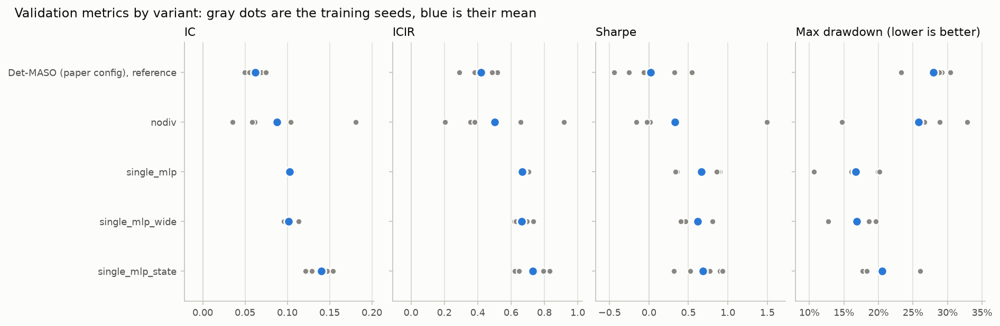
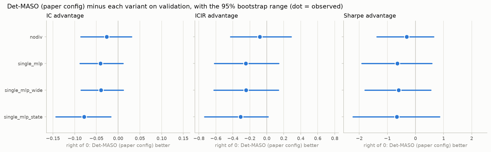
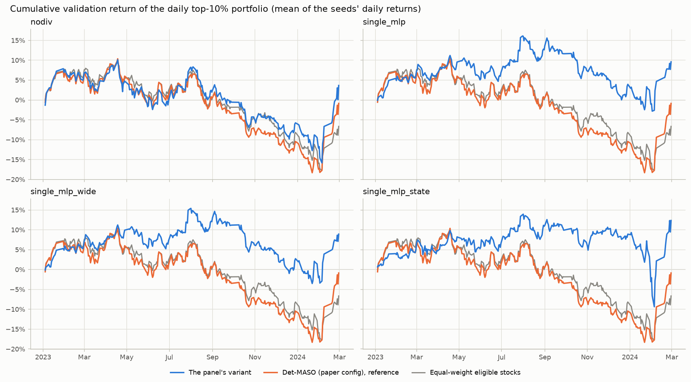

# Variant comparison: csi300, validation split

- Reference: `paper` (run group `final`). Advantage = reference minus variant (drawdown: variant minus reference), so a positive number means the reference did better.
- Evaluated dates: 2023-01-03 .. 2024-02-28 (278 trading days; IC uses 258). The test period is not used.
- Data tag `2026-11-04`, data hash `8e81084fb70adad6` (shared by every run group).
- Bootstrap: 10,000 draws; days redrawn in circular 20-day blocks (one draw shared by all variants); seeds redrawn per variant; RNG seed 0.
- Rule fixed in advance (plan D3): the reference is better if the 95% range lies entirely above 0, the variant is better if entirely below 0, otherwise no detectable difference. IC is primary; Sharpe is the second opinion.

## Run groups

| Variant | Config | Run group | Config hash | Model | Weights | Seeds |
|---|---|---|---|---|---|---|
| `paper` | `configs/csi300.yaml` | `final` | `d2a65e9a6a237d2c` | detmaso | 26,634 | 0 1 2 3 4 |
| `nodiv` | `configs/csi300_nodiv.yaml` | `nodiv` | `95dc0657f33ab915` | detmaso | 26,634 | 0 1 2 3 4 |
| `single_mlp` | `configs/csi300_single_mlp.yaml` | `single_mlp` | `ef0560a807c0b155` | single_mlp | 4,865 | 0 1 2 3 4 |
| `single_mlp_wide` | `configs/csi300_single_mlp_wide.yaml` | `single_mlp_wide` | `6964fbf8c1ad4259` | single_mlp | 26,731 | 0 1 2 3 4 |
| `single_mlp_state` | `configs/csi300_single_mlp_state.yaml` | `single_mlp_state` | `d38afb377e8a652b` | single_mlp | 5,633 | 0 1 2 3 4 |

## Metrics (mean +- std over seeds)

| Variant | IC | ICIR | Sharpe | Max drawdown | Annual return | Excess AR | Excess Sharpe |
|---|---|---|---|---|---|---|---|
| `paper` | 0.0620 +- 0.0102 | 0.420 +- 0.091 | 0.02 +- 0.41 | 28.0% +- 2.8% | -0.9% +- 7.0% | 5.1% | 0.47 |
| `nodiv` | 0.0880 +- 0.0575 | 0.503 +- 0.283 | 0.33 +- 0.67 | 25.8% +- 6.7% | 3.2% +- 10.4% | 9.4% | 0.80 |
| `single_mlp` | 0.1028 +- 0.0024 | 0.668 +- 0.026 | 0.66 +- 0.29 | 16.7% +- 3.8% | 8.3% +- 4.0% | 14.4% | 2.04 |
| `single_mlp_wide` | 0.1014 +- 0.0072 | 0.665 +- 0.048 | 0.62 +- 0.19 | 16.9% +- 2.6% | 7.7% +- 2.8% | 13.7% | 1.90 |
| `single_mlp_state` | 0.1404 +- 0.0142 | 0.729 +- 0.092 | 0.69 +- 0.26 | 20.6% +- 3.3% | 10.6% +- 4.7% | 17.0% | 1.52 |

## Advantage of `paper` over each variant (95% bootstrap range)

| Variant | IC adv. [95%] | P(>0) | ICIR adv. [95%] | P(>0) | Sharpe adv. [95%] | P(>0) | IC rule | Sharpe rule | MDD adv. |
|---|---|---|---|---|---|---|---|---|---|
| `nodiv` | -0.0261 [-0.0863, +0.0310] | 17% | -0.083 [-0.427, +0.287] | 27% | -0.31 [-1.37, +0.65] | 25% | no detectable difference | no detectable difference | -2.2% |
| `single_mlp` | -0.0409 [-0.0878, +0.0114] | 5% | -0.248 [-0.617, +0.140] | 8% | -0.64 [-1.91, +0.58] | 13% | no detectable difference | no detectable difference | -11.2% |
| `single_mlp_wide` | -0.0395 [-0.0857, +0.0120] | 6% | -0.245 [-0.623, +0.139] | 8% | -0.60 [-1.80, +0.54] | 14% | no detectable difference | no detectable difference | -11.1% |
| `single_mlp_state` | -0.0784 [-0.1435, -0.0166] | 1% | -0.309 [-0.735, +0.015] | 3% | -0.67 [-2.22, +0.86] | 16% | variant better | no detectable difference | -7.4% |

P(>0) = share of bootstrap draws in which the reference did better.

## Early-stopping check

| Variant | IC at the picked epoch (headline) | Validation IC averaged over every epoch | Gain from picking | Mean epochs trained |
|---|---|---|---|---|
| `paper` | 0.0620 | 0.0426 | +0.0194 | 16.8 |
| `nodiv` | 0.0880 | 0.0426 | +0.0454 | 15.8 |
| `single_mlp` | 0.1028 | 0.0932 | +0.0097 | 18.6 |
| `single_mlp_wide` | 0.1014 | 0.0948 | +0.0066 | 18.2 |
| `single_mlp_state` | 0.1404 | 0.0987 | +0.0417 | 13.0 |

Each model's epoch was picked by the smoothed validation IC, i.e. on the same days compared here, so the headline IC is
optimistic, most of all for runs whose validation IC swings from epoch to epoch. The all-epoch average involves no picking.

## Agents and scheduler (multi-agent variants)

| Variant | Mean abs agent rank corr | Scheduler entropy (max ln n) | Effective agents per day | Mean agent weights |
|---|---|---|---|---|
| `paper` | 0.102 | 0.014 (max 1.61) | 1.02 | [0.591, 0.0, 0.408, 0.0, 0.0] |
| `nodiv` | 0.413 | 0.051 (max 1.61) | 1.07 | [0.249, 0.013, 0.581, 0.001, 0.157] |

Effective agents per day = mean over days of exp(scheduler entropy): 1 = one agent takes all the weight, n = equal weights.

## Per seed

| Variant | Seed | IC | ICIR | Sharpe | Max drawdown | Annual return | Best epoch | Epochs |
|---|---|---|---|---|---|---|---|---|
| `paper` | 0 | 0.0617 | 0.422 | 0.33 | 29.2% | 4.6% | 13 | 21 |
| `paper` | 1 | 0.0494 | 0.289 | -0.07 | 28.8% | -3.2% | 4 | 12 |
| `paper` | 2 | 0.0687 | 0.519 | -0.25 | 30.4% | -5.7% | 8 | 16 |
| `paper` | 3 | 0.0552 | 0.383 | -0.44 | 28.1% | -8.5% | 10 | 18 |
| `paper` | 4 | 0.0748 | 0.487 | 0.54 | 23.3% | 8.1% | 9 | 17 |
| `nodiv` | 0 | 0.0618 | 0.356 | 0.02 | 28.9% | -1.7% | 3 | 11 |
| `nodiv` | 1 | 0.1809 | 0.917 | 1.49 | 14.7% | 20.5% | 13 | 21 |
| `nodiv` | 2 | 0.0582 | 0.380 | -0.02 | 26.6% | -1.9% | 7 | 15 |
| `nodiv` | 3 | 0.0353 | 0.204 | -0.16 | 32.8% | -5.7% | 3 | 11 |
| `nodiv` | 4 | 0.1040 | 0.656 | 0.34 | 26.0% | 4.7% | 13 | 21 |
| `single_mlp` | 0 | 0.1068 | 0.707 | 0.35 | 19.9% | 4.0% | 11 | 19 |
| `single_mlp` | 1 | 0.1026 | 0.682 | 0.90 | 10.7% | 11.0% | 4 | 12 |
| `single_mlp` | 2 | 0.1005 | 0.646 | 0.34 | 20.2% | 3.8% | 10 | 18 |
| `single_mlp` | 3 | 0.1017 | 0.647 | 0.88 | 16.8% | 11.3% | 14 | 22 |
| `single_mlp` | 4 | 0.1026 | 0.656 | 0.86 | 16.1% | 11.2% | 14 | 22 |
| `single_mlp_wide` | 0 | 0.0963 | 0.618 | 0.81 | 16.8% | 10.6% | 13 | 21 |
| `single_mlp_wide` | 1 | 0.0957 | 0.629 | 0.80 | 16.7% | 9.7% | 9 | 17 |
| `single_mlp_wide` | 2 | 0.1015 | 0.695 | 0.46 | 12.7% | 4.8% | 5 | 13 |
| `single_mlp_wide` | 3 | 0.1134 | 0.732 | 0.62 | 19.6% | 8.4% | 11 | 19 |
| `single_mlp_wide` | 4 | 0.1003 | 0.652 | 0.41 | 18.6% | 4.7% | 13 | 21 |
| `single_mlp_state` | 0 | 0.1497 | 0.833 | 0.52 | 20.5% | 7.7% | 4 | 12 |
| `single_mlp_state` | 1 | 0.1214 | 0.622 | 0.31 | 26.1% | 4.0% | 5 | 13 |
| `single_mlp_state` | 2 | 0.1474 | 0.749 | 0.77 | 17.7% | 11.6% | 5 | 13 |
| `single_mlp_state` | 3 | 0.1292 | 0.649 | 0.90 | 20.1% | 14.4% | 5 | 13 |
| `single_mlp_state` | 4 | 0.1541 | 0.795 | 0.93 | 18.3% | 15.3% | 6 | 14 |

## Figures

