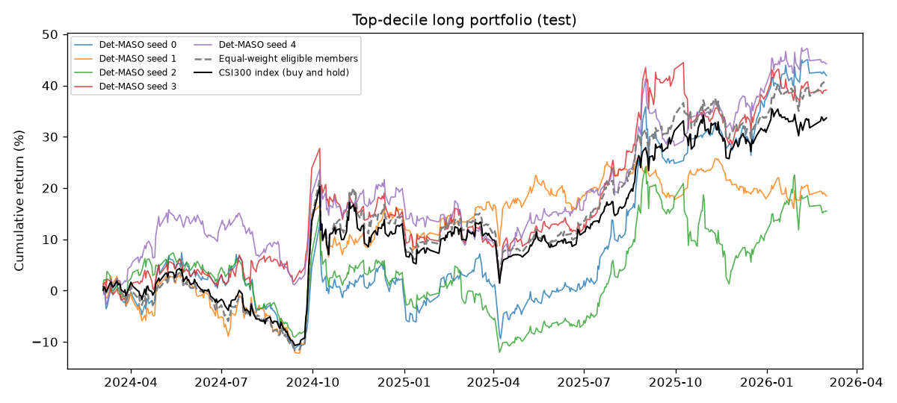
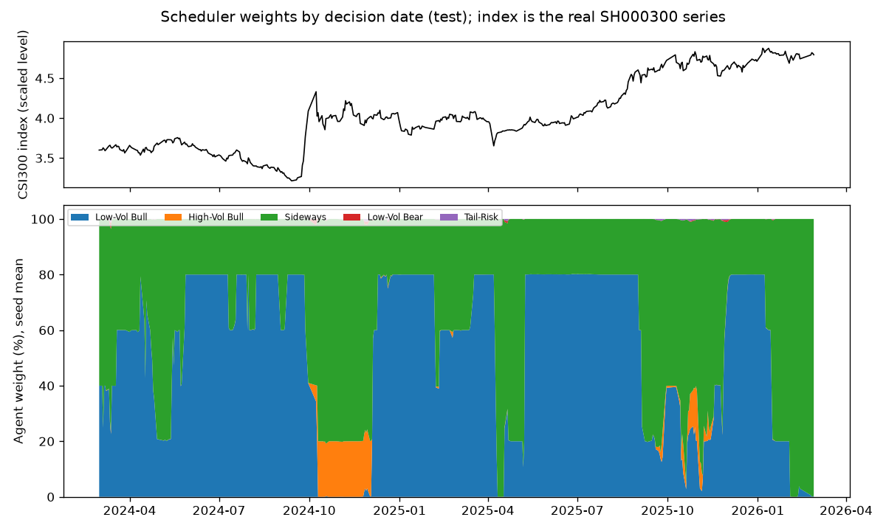
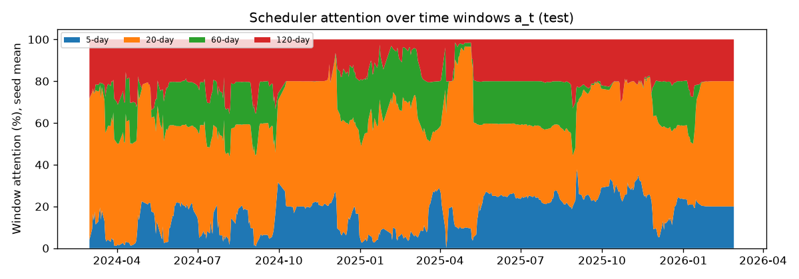
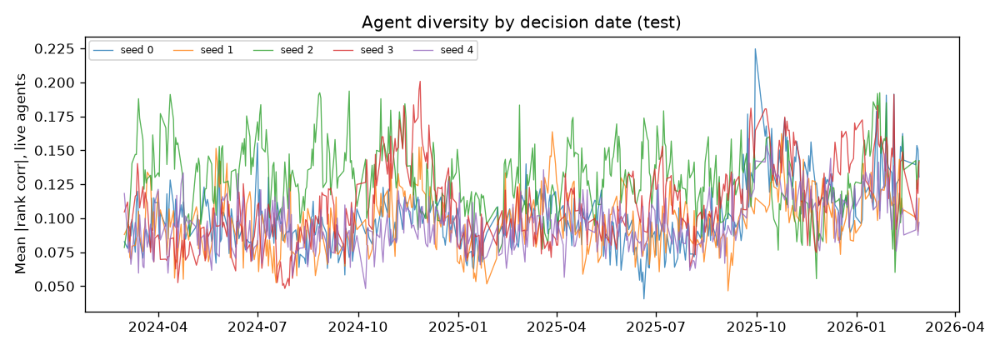
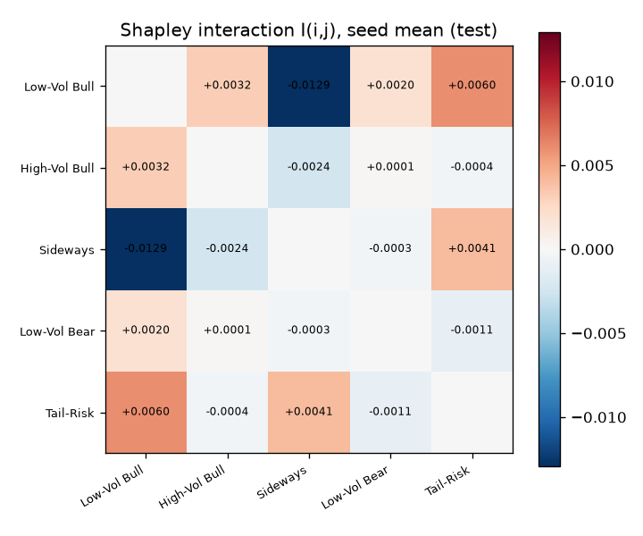
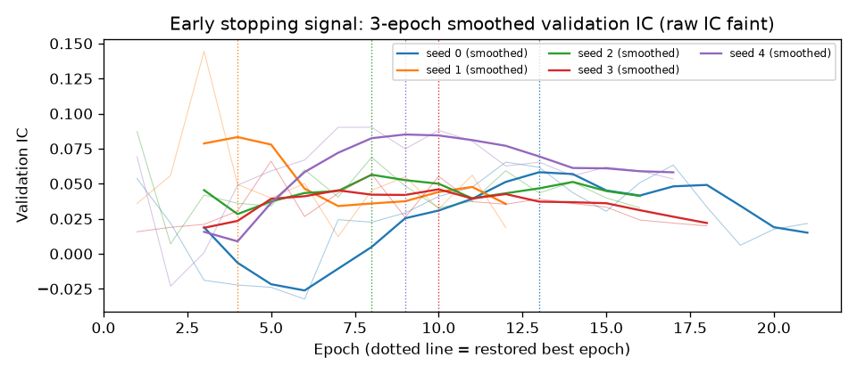

# Det-MASO reproduction: csi300, test split

- Run group `final`, seeds [0, 1, 2, 3, 4], config hash `d2a65e9a6a237d2c`, data tag `2026-11-04`
- Evaluated dates: 2024-03-01 .. 2026-02-27 (482 trading days; IC uses 482)
- Changes from the approved plan: see DEVIATIONS.md
- Test-period lock: opening 1 recorded in locks/csi300_test.json (first opening); code 96485481d17a9fad

## Headline metrics (mean +- std over seeds)

| Metric | Ours | Paper (Table 5/7) | Band status |
|---|---|---|---|
| IC | 0.038 +- 0.008 | 0.081 | outside |
| ICIR | 0.183 +- 0.040 | 0.620 | outside |
| Sharpe | 0.808 +- 0.290 | 1.850 | outside |
| Annual return | 14.7% +- 6.0% | 31.5% | outside |
| Max drawdown | 19.1% +- 3.0% | 8.5% | outside |

## Per seed

| Seed | IC | ICIR | Sharpe | AR | MDD | Qlib AR | Qlib IR | Qlib MDD | Excess AR | Excess Sharpe | Excess MDD | Best epoch | Epochs |
|---|---|---|---|---|---|---|---|---|---|---|---|---|---|
| 0 | 0.0511 | 0.238 | 0.93 | 19.1% | 19.7% | 19.5% | 0.93 | 20.6% | -0.2% | 0.06 | 23.7% | 13 | 21 |
| 1 | 0.0378 | 0.172 | 0.56 | 8.8% | 16.0% | 10.0% | 0.55 | 16.9% | -9.1% | -0.75 | 24.8% | 4 | 12 |
| 2 | 0.0338 | 0.164 | 0.45 | 7.5% | 23.4% | 9.3% | 0.45 | 25.6% | -10.0% | -0.67 | 29.8% | 8 | 16 |
| 3 | 0.0392 | 0.204 | 0.98 | 17.9% | 19.8% | 18.0% | 0.97 | 21.1% | -1.4% | -0.05 | 18.4% | 10 | 18 |
| 4 | 0.0298 | 0.135 | 1.12 | 20.1% | 16.7% | 19.6% | 1.12 | 17.3% | -0.1% | 0.07 | 22.8% | 9 | 17 |

Headline = compounded annual growth, Sharpe with observed trading days per year, drawdown of the value curve.
Qlib = risk_analysis sum mode with 238 days. Excess = minus the equal-weighted average of the eligible members
(index members that traded on t-1 and t; see DEVIATIONS.md).

## Sub-window 2024-03-01 .. 2025-04-18 (Figure 4's actual span; comparison only)

| Seed | IC | ICIR | Sharpe | AR | MDD | Excess AR | Excess Sharpe |
|---|---|---|---|---|---|---|---|
| 0 | 0.0636 | 0.258 | -0.05 | -3.6% | 19.7% | -11.0% | -0.78 |
| 1 | 0.1094 | 0.554 | 0.76 | 15.5% | 16.0% | 6.7% | 0.60 |
| 2 | 0.0489 | 0.206 | -0.35 | -8.8% | 23.4% | -16.2% | -1.31 |
| 3 | 0.0470 | 0.212 | 0.51 | 8.6% | 19.8% | -0.1% | 0.05 |
| 4 | 0.0211 | 0.086 | 0.47 | 7.7% | 16.7% | -1.4% | -0.02 |

## Diversity, scheduler and dead agents

| Quantity | Ours (mean over seeds) | Paper |
|---|---|---|
| Mean abs pairwise corr, last training epochs (Fig. 3 protocol) | 0.044 | 0.49 (suspect, see docs/PLAN.md Sec 12) |
| Mean log det Sigma, last training epochs | -0.064 | -0.28 (impossible for 5 agents) |
| Mean live agents per day, last training epochs | 4.99 | 5 |
| Mean abs pairwise rank corr over the test period (live agents) | 0.107 | - |
| Mean log det over the test period (live agents) | -0.205 | - |
| Mean scheduler entropy over the test period (max ln 5 = 1.609) | 0.032 | - |
| Mean agent weights | [0.541, 0.022, 0.436, 0.0, 0.001] | - |

Dead agent-days over the test period (agent output constant across stocks; DEVIATIONS 4):

| Seed | Low-Vol Bull | High-Vol Bull | Sideways | Low-Vol Bear | Tail-Risk |
|---|---|---|---|---|---|
| 0 | 0 | 0 | 0 | 23 | 0 |
| 1 | 0 | 0 | 0 | 0 | 0 |
| 2 | 0 | 0 | 0 | 0 | 0 |
| 3 | 0 | 0 | 0 | 0 | 0 |
| 4 | 0 | 0 | 0 | 0 | 0 |

## Shapley interaction I(i,j): mean +- std over seeds

|  | Low-Vol Bull | High-Vol Bull | Sideways | Low-Vol Bear | Tail-Risk |
|---|---|---|---|---|---|
| Low-Vol Bull | - | +0.0032 +- 0.0078 | -0.0129 +- 0.0117 | +0.0020 +- 0.0058 | +0.0060 +- 0.0070 |
| High-Vol Bull | +0.0032 +- 0.0078 | - | -0.0024 +- 0.0110 | +0.0001 +- 0.0033 | -0.0004 +- 0.0017 |
| Sideways | -0.0129 +- 0.0117 | -0.0024 +- 0.0110 | - | -0.0003 +- 0.0062 | +0.0041 +- 0.0062 |
| Low-Vol Bear | +0.0020 +- 0.0058 | +0.0001 +- 0.0033 | -0.0003 +- 0.0062 | - | -0.0011 +- 0.0031 |
| Tail-Risk | +0.0060 +- 0.0070 | -0.0004 +- 0.0017 | +0.0041 +- 0.0062 | -0.0011 +- 0.0031 | - |

v(all agents) = 0.0383; single agents: Low-Vol Bull 0.0094, High-Vol Bull 0.0008, Sideways 0.0392, Low-Vol Bear -0.0007, Tail-Risk -0.0086
Coalition-days with a constant score (IC set to 0): 23

## Qualitative checks (docs/PLAN.md Section 10)

| Check | Ours | Target | Holds? |
|---|---|---|---|
| q1 agents stay different (mean abs corr) | 0.107 | < 0.7 | True |
| q2 scheduler does not collapse (mean entropy) | 0.032 | > 0.80 | False |
| q3 Tail-Risk share of training days | 2.2% | 3%-7% | False |
| q4 I(Low-Vol Bull, Tail-Risk) > 0 | 4 of 5 seeds | >= 4 of 5 seeds | True |
| q4b ... and it is the largest pair | 2 of 5 seeds | reported | - |

## Verdict: **Not reproduced**

Rules applied in order (docs/PLAN.md Section 10): floor, reproduced, partially reproduced, inconclusive.

Criteria not met:

- IC 0.038 below the paper's single-MLP floor 0.055
- Sharpe 0.81 below the paper's single-MLP floor 1.05

## Figures

