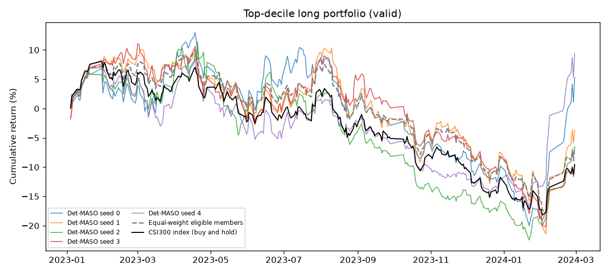
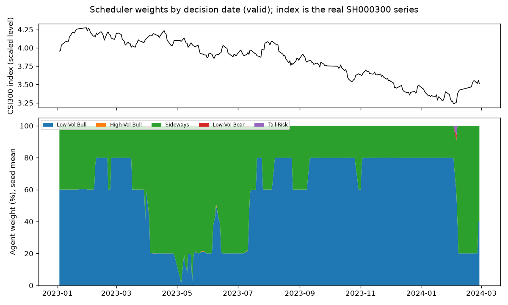
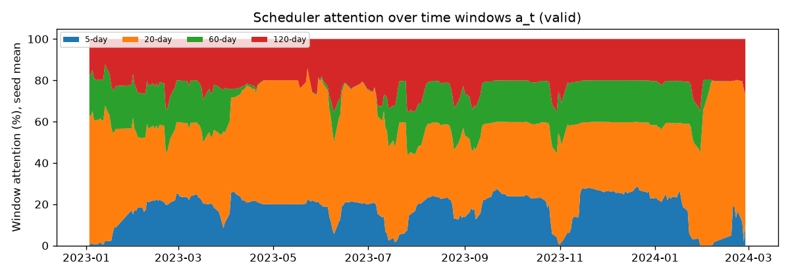
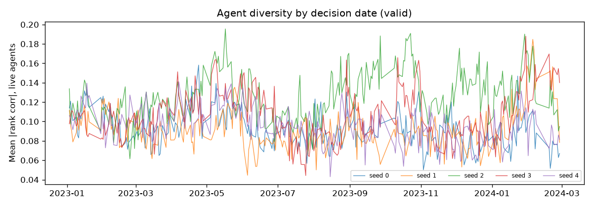
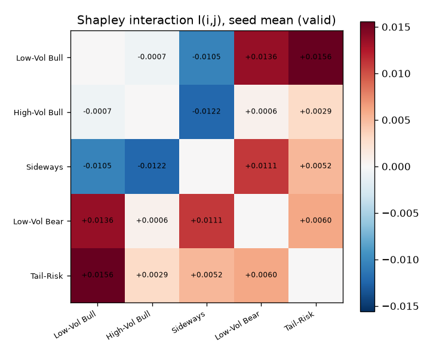
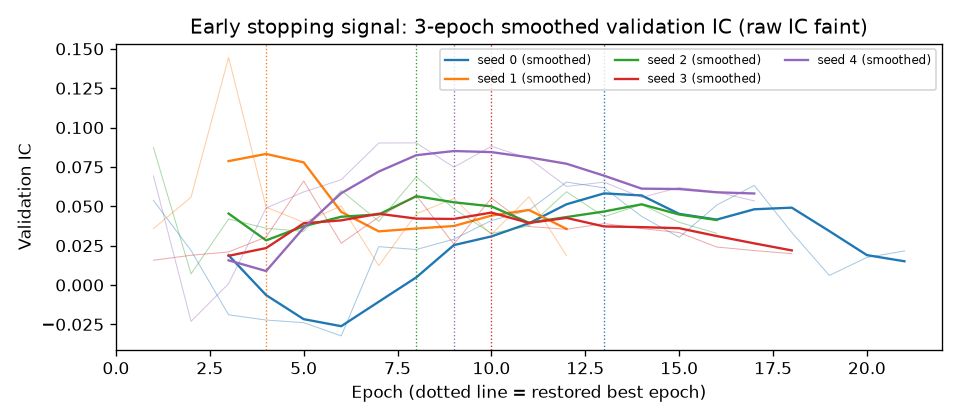

# Det-MASO reproduction: csi300, valid split

- Run group `final`, seeds [0, 1, 2, 3, 4], config hash `d2a65e9a6a237d2c`, data tag `2026-11-04`
- Evaluated dates: 2023-01-03 .. 2024-02-28 (278 trading days; IC uses 258)
- Changes from the approved plan: see DEVIATIONS.md

## Headline metrics (mean +- std over seeds)

| Metric | Ours | Paper (Table 5/7) | Band status |
|---|---|---|---|
| IC | 0.062 +- 0.010 | 0.081 | close band |
| ICIR | 0.420 +- 0.091 | 0.620 | close band |
| Sharpe | 0.021 +- 0.408 | 1.850 | outside |
| Annual return | -0.9% +- 7.0% | 31.5% | outside |
| Max drawdown | 28.0% +- 2.8% | 8.5% | outside |

## Per seed

| Seed | IC | ICIR | Sharpe | AR | MDD | Qlib AR | Qlib IR | Qlib MDD | Excess AR | Excess Sharpe | Excess MDD | Best epoch | Epochs |
|---|---|---|---|---|---|---|---|---|---|---|---|---|---|
| 0 | 0.0617 | 0.422 | 0.33 | 4.6% | 29.2% | 6.3% | 0.32 | 33.5% | 11.1% | 0.94 | 12.2% | 13 | 21 |
| 1 | 0.0494 | 0.289 | -0.07 | -3.2% | 28.8% | -1.3% | -0.07 | 32.8% | 3.2% | 0.38 | 7.6% | 4 | 12 |
| 2 | 0.0687 | 0.519 | -0.25 | -5.7% | 30.4% | -4.3% | -0.25 | 35.5% | -0.4% | 0.04 | 16.9% | 8 | 16 |
| 3 | 0.0552 | 0.383 | -0.44 | -8.5% | 28.1% | -7.4% | -0.44 | 31.8% | -3.0% | -0.29 | 8.7% | 10 | 18 |
| 4 | 0.0748 | 0.487 | 0.54 | 8.1% | 23.3% | 9.1% | 0.54 | 25.7% | 14.4% | 1.28 | 9.3% | 9 | 17 |

Headline = compounded annual growth, Sharpe with observed trading days per year, drawdown of the value curve.
Qlib = risk_analysis sum mode with 238 days. Excess = minus the equal-weighted average of the eligible members
(index members that traded on t-1 and t; see DEVIATIONS.md).

## Diversity, scheduler and dead agents

| Quantity | Ours (mean over seeds) | Paper |
|---|---|---|
| Mean abs pairwise corr, last training epochs (Fig. 3 protocol) | 0.044 | 0.49 (suspect, see docs/PLAN.md Sec 12) |
| Mean log det Sigma, last training epochs | -0.064 | -0.28 (impossible for 5 agents) |
| Mean live agents per day, last training epochs | 4.99 | 5 |
| Mean abs pairwise rank corr over the valid period (live agents) | 0.102 | - |
| Mean log det over the valid period (live agents) | -0.182 | - |
| Mean scheduler entropy over the valid period (max ln 5 = 1.609) | 0.014 | - |
| Mean agent weights | [0.591, 0.0, 0.408, 0.0, 0.0] | - |

Dead agent-days over the valid period (agent output constant across stocks; DEVIATIONS 4):

| Seed | Low-Vol Bull | High-Vol Bull | Sideways | Low-Vol Bear | Tail-Risk |
|---|---|---|---|---|---|
| 0 | 0 | 0 | 0 | 8 | 0 |
| 1 | 0 | 0 | 0 | 0 | 0 |
| 2 | 0 | 0 | 0 | 0 | 0 |
| 3 | 0 | 0 | 0 | 0 | 0 |
| 4 | 0 | 0 | 0 | 0 | 0 |

## Shapley interaction I(i,j): mean +- std over seeds

|  | Low-Vol Bull | High-Vol Bull | Sideways | Low-Vol Bear | Tail-Risk |
|---|---|---|---|---|---|
| Low-Vol Bull | - | -0.0007 +- 0.0191 | -0.0105 +- 0.0346 | +0.0136 +- 0.0121 | +0.0156 +- 0.0149 |
| High-Vol Bull | -0.0007 +- 0.0191 | - | -0.0122 +- 0.0355 | +0.0006 +- 0.0086 | +0.0029 +- 0.0110 |
| Sideways | -0.0105 +- 0.0346 | -0.0122 +- 0.0355 | - | +0.0111 +- 0.0113 | +0.0052 +- 0.0198 |
| Low-Vol Bear | +0.0136 +- 0.0121 | +0.0006 +- 0.0086 | +0.0111 +- 0.0113 | - | +0.0060 +- 0.0066 |
| Tail-Risk | +0.0156 +- 0.0149 | +0.0029 +- 0.0110 | +0.0052 +- 0.0198 | +0.0060 +- 0.0066 | - |

v(all agents) = 0.0620; single agents: Low-Vol Bull 0.0174, High-Vol Bull 0.0093, Sideways 0.0358, Low-Vol Bear -0.0313, Tail-Risk -0.0297
Coalition-days with a constant score (IC set to 0): 7

## Qualitative checks (docs/PLAN.md Section 10)

| Check | Ours | Target | Holds? |
|---|---|---|---|
| q1 agents stay different (mean abs corr) | 0.102 | < 0.7 | True |
| q2 scheduler does not collapse (mean entropy) | 0.014 | > 0.80 | False |
| q3 Tail-Risk share of training days | 2.2% | 3%-7% | False |
| q4 I(Low-Vol Bull, Tail-Risk) > 0 | 4 of 5 seeds | >= 4 of 5 seeds | True |
| q4b ... and it is the largest pair | 3 of 5 seeds | reported | - |

Validation is for development only; the verdict is computed on the test period (Milestone 9).

## Figures

