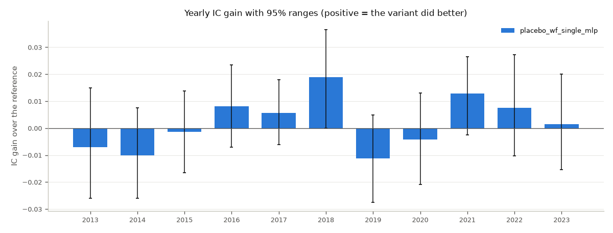

# Walk-forward comparison: csi300

- Reference: `placebo_wf_paper` (run group `placebo`). Gain = variant minus reference, so a positive number means the variant did better.
- 11 test years (2013-2023), 2708 test days from 2013-01-04 to 2024-02-29; seeds [0, 1, 2, 3, 4]. The locked test period is never used.
- 95% ranges: 10,000 draws; days redrawn in circular 20-day blocks within each test year (shared by every run group), seeds redrawn per run group from its own random stream (docs/RULES.md, Rule WK).
- "After costs" = realistic costs with blocked trades (Rule WT).
- **Placebo**: every run group was trained and evaluated on shuffled answers (seed 0); there is nothing real to find.

## Run groups

| Variant | Config | Run group | Config hash | Model | Try # |
|---|---|---|---|---|---|
| `placebo_wf_paper` | `configs/walkforward/placebo/paper.yaml` | `placebo` | `9515c4dbd6f711d2` | detmaso | - |
| `placebo_wf_single_mlp` | `configs/walkforward/placebo/single_mlp.yaml` | `placebo_single` | `d820628005c10957` | single_mlp | - |

## Each run group (all test years joined; mean +- std over seeds [95% range])

| Variant | Average IC | Sharpe, paper backtest | Sharpe after costs | Annual return after costs | Turnover/day | Long-short (bps/day) |
|---|---|---|---|---|---|---|
| `placebo_wf_paper` | 0.0010 +- 0.0023 [-0.0031, +0.0051] | 0.29 [-0.28, +0.88] | -0.69 +- 0.15 [-1.23, -0.14] | -17.7% | 37.4% | -0.2 |
| `placebo_wf_single_mlp` | 0.0028 +- 0.0015 [-0.0025, +0.0081] | 0.30 [-0.25, +0.89] | -0.40 +- 0.07 [-0.92, +0.16] | -11.7% | 26.4% | 0.1 |

## Yearly IC gain over `placebo_wf_paper` [95% range]

| Year | `placebo_wf_single_mlp` |
|---|---|
| 2013 | -0.0071 [-0.0260, +0.0150] |
| 2014 | -0.0102 [-0.0260, +0.0075] |
| 2015 | -0.0014 [-0.0166, +0.0139] |
| 2016 | +0.0081 [-0.0071, +0.0235] |
| 2017 | +0.0057 [-0.0061, +0.0179] |
| 2018 | +0.0189 [+0.0000, +0.0365] |
| 2019 | -0.0112 [-0.0275, +0.0050] |
| 2020 | -0.0042 [-0.0209, +0.0131] |
| 2021 | +0.0128 [-0.0025, +0.0264] |
| 2022 | +0.0076 [-0.0102, +0.0272] |
| 2023 | +0.0015 [-0.0155, +0.0201] |

## Gains in brief

| Variant | Average IC gain [95%] | Years won | Seeds gaining | After-cost Sharpe difference [95%] |
|---|---|---|---|---|
| `placebo_wf_single_mlp` | +0.0018 [-0.0031, +0.0068] | 6 of 11 | 4 of 5 | +0.29 [+0.11, +0.48] |

## Rule WP: placebo (docs/RULES.md)

- P1 average IC range not entirely above 0: `placebo_wf_paper` [-0.0031, +0.0051]; `placebo_wf_single_mlp` [-0.0025, +0.0081]: yes.
- P2 Rule WK never says "improvement": placebo_wf_paper vs placebo_wf_single_mlp: no improvement; placebo_wf_single_mlp vs placebo_wf_paper: no improvement: yes.
- **Placebo passed.**

## Figures

