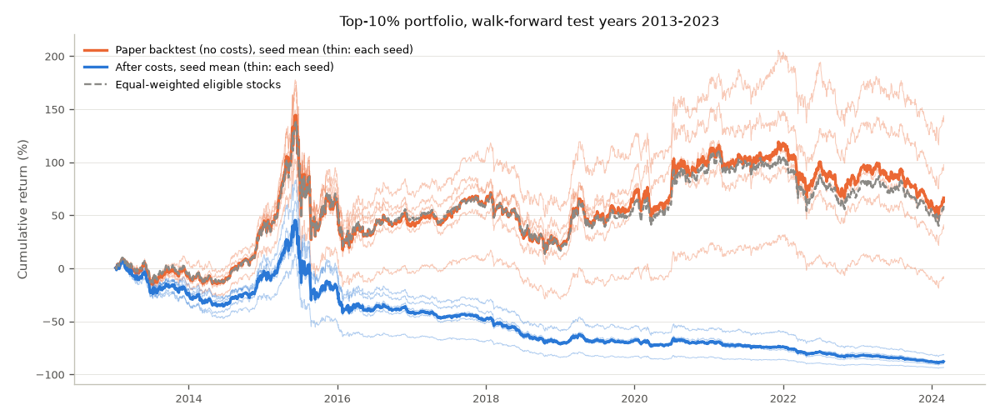
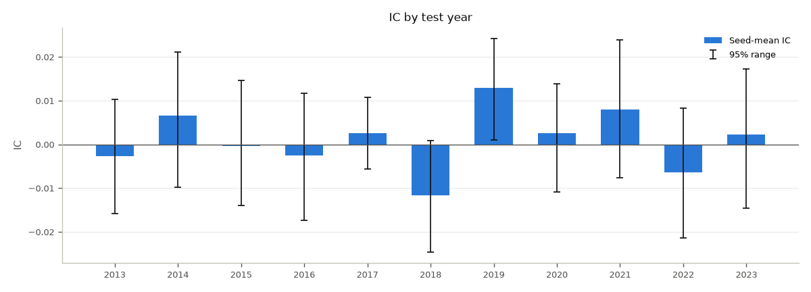

# Walk-forward evaluation: `placebo_wf_paper` (csi300)

- Run group `placebo`, config `configs/walkforward/placebo/paper.yaml` (hash `9515c4dbd6f711d2`), data tag `2026-11-04`, data hash `7470fa641726f353`.
- 11 folds (test years 2013-2023), seeds [0, 1, 2, 3, 4]: 2708 test days from 2013-01-04 to 2024-02-29. Each fold trains from 2008-01-01 to two years before its test year and early-stops on the year before (docs/RULES.md, Rule WL). The locked test period is never used.
- Every number is the mean +- std over seeds; 95% ranges come from the paired, stratified 20-day block resampling (Rule WK).
- Costs (Rule WT): flat 0, 10, 20 bps per buy and per sell, and realistic: buys 8 bps, sells 8 bps + stamp duty (10 bps from 2008-09-19; 5 bps from 2023-08-28). "After costs" = realistic costs with blocked trades (price limits, suspensions).
- **Placebo**: trained and evaluated on shuffled answers (seed 0); holdings are valued with the shuffled next-day returns. There is nothing real to find.

## Headline (all test years joined)

| Metric | Mean +- std over seeds | 95% range |
|---|---|---|
| Average IC (mean of the yearly ICs) | 0.0010 +- 0.0023 | [-0.0031, +0.0051] |
| Sharpe, paper backtest (no costs, no blocking) | 0.29 +- 0.14 | [-0.28, +0.88] |
| Sharpe after costs | -0.69 +- 0.15 | [-1.23, -0.14] |
| Annual return after costs | -17.7% +- 2.8% | - |
| Max drawdown after costs | 92.8% +- 1.6% | - |
| Excess annual return after costs (vs equal-weighted eligible stocks) | -21.0% +- 2.8% | - |
| Daily turnover, one-way (without / with blocking) | 37.4% +- 1.4% / 37.4% | - |
| Long-short spread, gross (bps per day; Sharpe) | -0.2 +- 1.3; -0.06 +- 0.36 | - |
| Blocked trades per day; average cash share (blocking) | 0.34; 0.01% | - |

## By test year

| Year | Days | IC | IC 95% range | ICIR | Long-short (bps/day) | Sharpe, paper backtest | Sharpe after costs | Excess return after costs | Turnover/day | Blocked trades/day |
|---|---|---|---|---|---|---|---|---|---|---|
| 2013 | 238 | -0.0027 +- 0.0077 | [-0.0159, +0.0103] | -0.04 +- 0.12 | -1.2 +- 3.7 | -0.16 +- 0.36 | -1.13 +- 0.49 | -20.9% +- 8.5% | 34.8% | 0.07 |
| 2014 | 245 | 0.0065 +- 0.0064 | [-0.0098, +0.0210] | 0.12 +- 0.11 | 1.2 +- 3.4 | 2.21 +- 0.25 | 1.26 +- 0.44 | -14.3% +- 8.2% | 29.0% | 0.21 |
| 2015 | 244 | -0.0005 +- 0.0083 | [-0.0140, +0.0146] | -0.01 +- 0.13 | -1.0 +- 5.4 | 0.29 +- 0.21 | -0.33 +- 0.30 | -27.9% +- 9.8% | 45.1% | 1.46 |
| 2016 | 244 | -0.0025 +- 0.0055 | [-0.0173, +0.0117] | -0.04 +- 0.08 | -0.5 +- 1.8 | -0.05 +- 0.12 | -0.81 +- 0.21 | -19.4% +- 4.6% | 31.9% | 0.26 |
| 2017 | 244 | 0.0025 +- 0.0053 | [-0.0056, +0.0107] | 0.05 +- 0.10 | 2.0 +- 1.3 | 1.25 +- 0.31 | -0.94 +- 0.32 | -19.4% +- 2.8% | 40.6% | 0.08 |
| 2018 | 243 | -0.0116 +- 0.0064 | [-0.0247, +0.0008] | -0.21 +- 0.12 | -1.1 +- 2.4 | -1.40 +- 0.29 | -2.60 +- 0.30 | -24.8% +- 5.2% | 42.3% | 0.20 |
| 2019 | 244 | 0.0129 +- 0.0054 | [+0.0010, +0.0242] | 0.23 +- 0.11 | 3.7 +- 2.0 | 1.91 +- 0.15 | 0.69 +- 0.29 | -18.7% +- 5.1% | 40.2% | 0.25 |
| 2020 | 243 | 0.0025 +- 0.0093 | [-0.0109, +0.0138] | 0.06 +- 0.18 | -2.8 +- 4.8 | 0.91 +- 0.36 | -0.15 +- 0.32 | -23.4% +- 5.5% | 38.8% | 0.38 |
| 2021 | 243 | 0.0079 +- 0.0069 | [-0.0077, +0.0239] | 0.14 +- 0.12 | -1.7 +- 3.9 | 0.37 +- 0.26 | -0.94 +- 0.41 | -17.3% +- 5.6% | 33.4% | 0.47 |
| 2022 | 242 | -0.0064 +- 0.0072 | [-0.0214, +0.0082] | -0.11 +- 0.13 | 0.2 +- 3.3 | -0.80 +- 0.25 | -1.96 +- 0.39 | -20.8% +- 7.0% | 37.3% | 0.20 |
| 2023 | 278 | 0.0022 +- 0.0100 | [-0.0146, +0.0172] | 0.05 +- 0.17 | -0.8 +- 1.3 | -0.48 +- 0.24 | -1.87 +- 0.29 | -21.8% +- 3.2% | 37.9% | 0.12 |

## Costs and blocked trades (all test years joined)

| Costs | Sharpe, no blocking | Annual return, no blocking | Sharpe, with blocking | Annual return, with blocking |
|---|---|---|---|---|
| none (paper backtest) | 0.29 +- 0.14 | 4.2% +- 3.4% | 0.28 +- 0.15 | 4.0% +- 3.8% |
| 0 bps | 0.29 +- 0.14 | 4.2% +- 3.4% | 0.28 +- 0.15 | 4.0% +- 3.8% |
| 10 bps | -0.46 +- 0.13 | -13.1% +- 2.7% | -0.47 +- 0.15 | -13.2% +- 3.0% |
| 20 bps | -1.22 +- 0.14 | -27.5% +- 2.3% | -1.23 +- 0.15 | -27.6% +- 2.5% |
| realistic | -0.68 +- 0.13 | -17.5% +- 2.6% | -0.69 +- 0.15 | -17.7% +- 2.8% |

## Market moods per fold (refit on each fold's pre-test days; rule A16 names)

Moods: 0: Low-Vol Bull, 1: High-Vol Bull, 2: Sideways, 3: Low-Vol Bear, 4: Tail-Risk. Shares are in %. Centre shift = distance between a mood's centre and the previous fold's, in standardized units; relabelled = share of the previous fold's fit days whose mood changed.

| Fold | Fit days | Best K (silhouette) | Training-day shares | Test-day shares | Centre shift | Relabelled |
|---|---|---|---|---|---|---|
| 2013 | 2008-01-02 .. 2012-12-31 | 2 | 27.6, 20.0, 15.6, 25.5, 11.3 | 75.2, 0.0, 0.0, 24.8, 0.0 | - | - |
| 2014 | 2008-01-02 .. 2013-12-31 | 2 | 21.0, 17.8, 12.2, 40.0, 9.1 | 35.9, 7.8, 0.0, 56.3, 0.0 | 0.60, 0.25, 0.09, 0.04, 0.03 | 2.6% |
| 2015 | 2008-01-02 .. 2014-12-31 | 2 | 34.3, 14.5, 11.3, 32.5, 7.4 | 0.0, 51.2, 36.9, 0.0, 11.9 | 0.25, 0.38, 0.51, 0.44, 0.38 | 5.8% |
| 2016 | 2008-01-02 .. 2015-12-31 | 2 | 10.3, 9.6, 32.5, 40.8, 6.8 | 0.0, 13.1, 14.8, 65.2, 7.0 | 3.56, 3.63, 4.34, 0.15, 1.41 | 58.4% |
| 2017 | 2008-01-02 .. 2016-12-30 | 2 | 31.9, 16.4, 11.6, 31.8, 8.4 | 98.8, 0.0, 0.0, 1.2, 0.0 | 4.91, 4.11, 4.25, 1.45, 0.27 | 87.1% |
| 2018 | 2008-01-02 .. 2017-12-29 | 2 | 34.2, 14.8, 12.7, 30.0, 8.2 | 70.8, 0.0, 0.0, 29.2, 0.0 | 1.51, 0.03, 0.02, 1.85, 0.02 | 60.6% |
| 2019 | 2008-01-02 .. 2018-12-28 | 2 | 36.4, 13.8, 11.6, 30.6, 7.5 | 52.0, 15.2, 0.0, 32.8, 0.0 | 1.75, 0.09, 0.12, 1.69, 0.09 | 61.7% |
| 2020 | 2008-01-02 .. 2019-12-31 | 2 | 37.7, 12.7, 10.4, 32.5, 6.7 | 14.0, 17.7, 0.0, 68.3, 0.0 | 0.10, 0.22, 0.12, 0.09, 0.09 | 2.4% |
| 2021 | 2008-01-02 .. 2020-12-31 | 2 | 40.9, 12.8, 9.4, 30.8, 6.2 | 0.0, 25.5, 0.0, 74.5, 0.0 | 0.10, 0.14, 0.03, 0.32, 0.00 | 4.3% |
| 2022 | 2008-01-02 .. 2021-12-31 | 2 | 12.4, 8.7, 54.7, 18.5, 5.7 | 0.0, 0.0, 3.3, 96.7, 0.0 | 5.00, 4.50, 5.89, 1.09, 0.06 | 76.2% |
| 2023 | 2008-01-02 .. 2022-12-30 | 2 | 11.9, 8.1, 51.4, 23.2, 5.4 | 0.0, 0.0, 73.7, 26.3, 0.0 | 0.07, 0.09, 0.03, 0.27, 0.08 | 2.0% |

## Early stopping per fold

| Fold | Training dates (trained on) | Early-stopping year | Best epoch per seed | Epochs run | Early-stop IC at the picked epoch | ... averaged over every epoch |
|---|---|---|---|---|---|---|
| 2013 | 2008-01-02 .. 2011-12-02 (956) | 2012-01-04 .. 2012-12-31 | 3 14 3 3 3 | 13.2 | 0.0043 +- 0.0100 | -0.0089 |
| 2014 | 2008-01-02 .. 2012-12-03 (1199) | 2013-01-04 .. 2013-12-31 | 11 8 14 13 9 | 19.0 | 0.0161 +- 0.0072 | 0.0076 |
| 2015 | 2008-01-02 .. 2013-12-03 (1437) | 2014-01-02 .. 2014-12-31 | 6 6 7 14 5 | 15.6 | 0.0122 +- 0.0055 | 0.0040 |
| 2016 | 2008-01-02 .. 2014-12-03 (1682) | 2015-01-05 .. 2015-12-31 | 17 4 8 13 5 | 17.4 | 0.0069 +- 0.0080 | -0.0012 |
| 2017 | 2008-01-02 .. 2015-12-03 (1926) | 2016-01-04 .. 2016-12-30 | 14 25 3 24 3 | 21.8 | 0.0115 +- 0.0032 | 0.0024 |
| 2018 | 2008-01-02 .. 2016-12-02 (2170) | 2017-01-03 .. 2017-12-29 | 13 8 3 6 6 | 15.2 | 0.0168 +- 0.0077 | 0.0062 |
| 2019 | 2008-01-02 .. 2017-12-01 (2414) | 2018-01-02 .. 2018-12-28 | 12 3 4 8 22 | 17.8 | 0.0046 +- 0.0052 | -0.0037 |
| 2020 | 2008-01-02 .. 2018-11-30 (2657) | 2019-01-02 .. 2019-12-31 | 10 10 6 17 8 | 18.2 | 0.0175 +- 0.0056 | 0.0085 |
| 2021 | 2008-01-02 .. 2019-12-03 (2901) | 2020-01-02 .. 2020-12-31 | 8 3 3 3 4 | 12.2 | 0.0069 +- 0.0056 | 0.0014 |
| 2022 | 2008-01-02 .. 2020-12-03 (3144) | 2021-01-04 .. 2021-12-31 | 12 7 6 6 7 | 15.6 | 0.0137 +- 0.0055 | 0.0065 |
| 2023 | 2008-01-02 .. 2021-12-03 (3387) | 2022-01-04 .. 2022-12-30 | 9 11 7 24 24 | 23.0 | 0.0153 +- 0.0047 | 0.0082 |

The early-stopping IC is the only number used to pick an epoch; the test year plays no part in it.

## Figures

