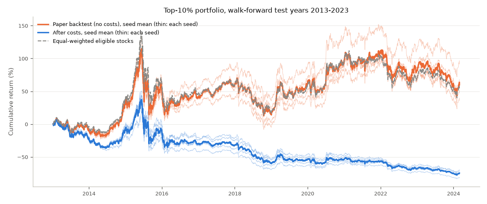
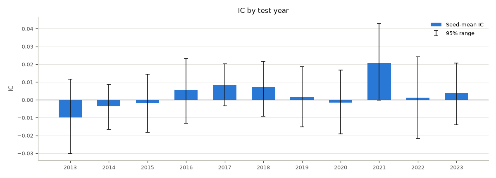

# Walk-forward evaluation: `placebo_wf_single_mlp` (csi300)

- Run group `placebo_single`, config `configs/walkforward/placebo/single_mlp.yaml` (hash `d820628005c10957`), data tag `2026-11-04`, data hash `7470fa641726f353`.
- 11 folds (test years 2013-2023), seeds [0, 1, 2, 3, 4]: 2708 test days from 2013-01-04 to 2024-02-29. Each fold trains from 2008-01-01 to two years before its test year and early-stops on the year before (docs/RULES.md, Rule WL). The locked test period is never used.
- Every number is the mean +- std over seeds; 95% ranges come from the paired, stratified 20-day block resampling (Rule WK).
- Costs (Rule WT): flat 0, 10, 20 bps per buy and per sell, and realistic: buys 8 bps, sells 8 bps + stamp duty (10 bps from 2008-09-19; 5 bps from 2023-08-28). "After costs" = realistic costs with blocked trades (price limits, suspensions).
- **Placebo**: trained and evaluated on shuffled answers (seed 0); holdings are valued with the shuffled next-day returns. There is nothing real to find.

## Headline (all test years joined)

| Metric | Mean +- std over seeds | 95% range |
|---|---|---|
| Average IC (mean of the yearly ICs) | 0.0028 +- 0.0015 | [-0.0025, +0.0081] |
| Sharpe, paper backtest (no costs, no blocking) | 0.30 +- 0.05 | [-0.25, +0.89] |
| Sharpe after costs | -0.40 +- 0.07 | [-0.92, +0.16] |
| Annual return after costs | -11.7% +- 1.5% | - |
| Max drawdown after costs | 83.9% +- 1.6% | - |
| Excess annual return after costs (vs equal-weighted eligible stocks) | -15.3% +- 1.4% | - |
| Daily turnover, one-way (without / with blocking) | 26.4% +- 1.7% / 26.5% | - |
| Long-short spread, gross (bps per day; Sharpe) | 0.1 +- 0.7; 0.02 +- 0.19 | - |
| Blocked trades per day; average cash share (blocking) | 0.41; 0.01% | - |

## By test year

| Year | Days | IC | IC 95% range | ICIR | Long-short (bps/day) | Sharpe, paper backtest | Sharpe after costs | Excess return after costs | Turnover/day | Blocked trades/day |
|---|---|---|---|---|---|---|---|---|---|---|
| 2013 | 238 | -0.0098 +- 0.0041 | [-0.0303, +0.0116] | -0.16 +- 0.07 | -0.3 +- 1.6 | -0.25 +- 0.10 | -0.99 +- 0.09 | -18.6% +- 1.8% | 26.2% | 0.04 |
| 2014 | 245 | -0.0037 +- 0.0072 | [-0.0166, +0.0087] | -0.06 +- 0.13 | -0.2 +- 2.5 | 2.04 +- 0.11 | 1.01 +- 0.27 | -18.1% +- 4.4% | 32.0% | 0.27 |
| 2015 | 244 | -0.0019 +- 0.0059 | [-0.0182, +0.0143] | -0.03 +- 0.10 | -2.1 +- 4.9 | 0.34 +- 0.10 | -0.05 +- 0.14 | -18.0% +- 5.7% | 28.7% | 1.74 |
| 2016 | 244 | 0.0056 +- 0.0103 | [-0.0132, +0.0233] | 0.09 +- 0.18 | -0.5 +- 1.9 | 0.07 +- 0.11 | -0.51 +- 0.12 | -12.9% +- 2.7% | 23.9% | 0.35 |
| 2017 | 244 | 0.0082 +- 0.0044 | [-0.0034, +0.0202] | 0.16 +- 0.08 | 2.2 +- 3.7 | 1.07 +- 0.35 | -0.22 +- 0.27 | -12.4% +- 2.8% | 24.5% | 0.13 |
| 2018 | 243 | 0.0072 +- 0.0060 | [-0.0093, +0.0216] | 0.13 +- 0.11 | 0.5 +- 3.3 | -1.44 +- 0.27 | -2.33 +- 0.21 | -19.2% +- 3.4% | 30.4% | 0.19 |
| 2019 | 244 | 0.0016 +- 0.0070 | [-0.0151, +0.0185] | 0.03 +- 0.11 | 0.0 +- 1.2 | 1.88 +- 0.16 | 0.90 +- 0.15 | -14.9% +- 2.8% | 33.5% | 0.26 |
| 2020 | 243 | -0.0017 +- 0.0084 | [-0.0193, +0.0167] | -0.03 +- 0.16 | -3.3 +- 1.5 | 0.89 +- 0.18 | 0.13 +- 0.19 | -18.3% +- 3.7% | 27.3% | 0.52 |
| 2021 | 243 | 0.0207 +- 0.0022 | [-0.0003, +0.0429] | 0.35 +- 0.03 | 2.9 +- 2.0 | 0.48 +- 0.15 | -0.31 +- 0.16 | -8.6% +- 2.4% | 19.6% | 0.59 |
| 2022 | 242 | 0.0011 +- 0.0065 | [-0.0218, +0.0241] | 0.02 +- 0.10 | 2.5 +- 1.9 | -0.65 +- 0.15 | -1.45 +- 0.16 | -11.9% +- 2.6% | 25.1% | 0.23 |
| 2023 | 278 | 0.0037 +- 0.0058 | [-0.0141, +0.0207] | 0.06 +- 0.10 | -0.8 +- 1.2 | -0.51 +- 0.24 | -1.24 +- 0.44 | -14.1% +- 5.9% | 20.3% | 0.22 |

## Costs and blocked trades (all test years joined)

| Costs | Sharpe, no blocking | Annual return, no blocking | Sharpe, with blocking | Annual return, with blocking |
|---|---|---|---|---|
| none (paper backtest) | 0.30 +- 0.05 | 4.5% +- 1.2% | 0.30 +- 0.05 | 4.3% +- 1.3% |
| 0 bps | 0.30 +- 0.05 | 4.5% +- 1.2% | 0.30 +- 0.05 | 4.3% +- 1.3% |
| 10 bps | -0.23 +- 0.06 | -8.1% +- 1.3% | -0.24 +- 0.06 | -8.3% +- 1.4% |
| 20 bps | -0.77 +- 0.08 | -19.2% +- 1.6% | -0.78 +- 0.09 | -19.4% +- 1.7% |
| realistic | -0.39 +- 0.06 | -11.5% +- 1.3% | -0.40 +- 0.07 | -11.7% +- 1.5% |

## Market moods per fold (refit on each fold's pre-test days; rule A16 names)

Moods: 0: Low-Vol Bull, 1: High-Vol Bull, 2: Sideways, 3: Low-Vol Bear, 4: Tail-Risk. Shares are in %. Centre shift = distance between a mood's centre and the previous fold's, in standardized units; relabelled = share of the previous fold's fit days whose mood changed.

| Fold | Fit days | Best K (silhouette) | Training-day shares | Test-day shares | Centre shift | Relabelled |
|---|---|---|---|---|---|---|
| 2013 | 2008-01-02 .. 2012-12-31 | 2 | 27.6, 20.0, 15.6, 25.5, 11.3 | 75.2, 0.0, 0.0, 24.8, 0.0 | - | - |
| 2014 | 2008-01-02 .. 2013-12-31 | 2 | 21.0, 17.8, 12.2, 40.0, 9.1 | 35.9, 7.8, 0.0, 56.3, 0.0 | 0.60, 0.25, 0.09, 0.04, 0.03 | 2.6% |
| 2015 | 2008-01-02 .. 2014-12-31 | 2 | 34.3, 14.5, 11.3, 32.5, 7.4 | 0.0, 51.2, 36.9, 0.0, 11.9 | 0.25, 0.38, 0.51, 0.44, 0.38 | 5.8% |
| 2016 | 2008-01-02 .. 2015-12-31 | 2 | 10.3, 9.6, 32.5, 40.8, 6.8 | 0.0, 13.1, 14.8, 65.2, 7.0 | 3.56, 3.63, 4.34, 0.15, 1.41 | 58.4% |
| 2017 | 2008-01-02 .. 2016-12-30 | 2 | 31.9, 16.4, 11.6, 31.8, 8.4 | 98.8, 0.0, 0.0, 1.2, 0.0 | 4.91, 4.11, 4.25, 1.45, 0.27 | 87.1% |
| 2018 | 2008-01-02 .. 2017-12-29 | 2 | 34.2, 14.8, 12.7, 30.0, 8.2 | 70.8, 0.0, 0.0, 29.2, 0.0 | 1.51, 0.03, 0.02, 1.85, 0.02 | 60.6% |
| 2019 | 2008-01-02 .. 2018-12-28 | 2 | 36.4, 13.8, 11.6, 30.6, 7.5 | 52.0, 15.2, 0.0, 32.8, 0.0 | 1.75, 0.09, 0.12, 1.69, 0.09 | 61.7% |
| 2020 | 2008-01-02 .. 2019-12-31 | 2 | 37.7, 12.7, 10.4, 32.5, 6.7 | 14.0, 17.7, 0.0, 68.3, 0.0 | 0.10, 0.22, 0.12, 0.09, 0.09 | 2.4% |
| 2021 | 2008-01-02 .. 2020-12-31 | 2 | 40.9, 12.8, 9.4, 30.8, 6.2 | 0.0, 25.5, 0.0, 74.5, 0.0 | 0.10, 0.14, 0.03, 0.32, 0.00 | 4.3% |
| 2022 | 2008-01-02 .. 2021-12-31 | 2 | 12.4, 8.7, 54.7, 18.5, 5.7 | 0.0, 0.0, 3.3, 96.7, 0.0 | 5.00, 4.50, 5.89, 1.09, 0.06 | 76.2% |
| 2023 | 2008-01-02 .. 2022-12-30 | 2 | 11.9, 8.1, 51.4, 23.2, 5.4 | 0.0, 0.0, 73.7, 26.3, 0.0 | 0.07, 0.09, 0.03, 0.27, 0.08 | 2.0% |

## Early stopping per fold

| Fold | Training dates (trained on) | Early-stopping year | Best epoch per seed | Epochs run | Early-stop IC at the picked epoch | ... averaged over every epoch |
|---|---|---|---|---|---|---|
| 2013 | 2008-01-02 .. 2011-12-02 (956) | 2012-01-04 .. 2012-12-31 | 3 3 3 7 3 | 11.8 | -0.0095 +- 0.0032 | -0.0150 |
| 2014 | 2008-01-02 .. 2012-12-03 (1199) | 2013-01-04 .. 2013-12-31 | 10 23 13 9 3 | 19.6 | 0.0161 +- 0.0091 | 0.0083 |
| 2015 | 2008-01-02 .. 2013-12-03 (1437) | 2014-01-02 .. 2014-12-31 | 9 10 7 11 4 | 16.2 | 0.0156 +- 0.0059 | 0.0074 |
| 2016 | 2008-01-02 .. 2014-12-03 (1682) | 2015-01-05 .. 2015-12-31 | 7 4 5 3 3 | 12.4 | -0.0014 +- 0.0061 | -0.0085 |
| 2017 | 2008-01-02 .. 2015-12-03 (1926) | 2016-01-04 .. 2016-12-30 | 3 6 3 5 5 | 12.4 | 0.0139 +- 0.0069 | 0.0034 |
| 2018 | 2008-01-02 .. 2016-12-02 (2170) | 2017-01-03 .. 2017-12-29 | 3 4 11 5 3 | 13.2 | 0.0172 +- 0.0038 | 0.0112 |
| 2019 | 2008-01-02 .. 2017-12-01 (2414) | 2018-01-02 .. 2018-12-28 | 12 11 18 20 12 | 22.6 | 0.0121 +- 0.0051 | 0.0050 |
| 2020 | 2008-01-02 .. 2018-11-30 (2657) | 2019-01-02 .. 2019-12-31 | 3 4 5 6 3 | 12.2 | 0.0097 +- 0.0053 | 0.0011 |
| 2021 | 2008-01-02 .. 2019-12-03 (2901) | 2020-01-02 .. 2020-12-31 | 3 4 3 3 3 | 11.2 | 0.0065 +- 0.0031 | -0.0021 |
| 2022 | 2008-01-02 .. 2020-12-03 (3144) | 2021-01-04 .. 2021-12-31 | 7 6 8 11 3 | 15.0 | 0.0218 +- 0.0032 | 0.0141 |
| 2023 | 2008-01-02 .. 2021-12-03 (3387) | 2022-01-04 .. 2022-12-30 | 12 13 4 6 3 | 15.6 | 0.0071 +- 0.0060 | 0.0023 |

The early-stopping IC is the only number used to pick an epoch; the test year plays no part in it.

## Figures

